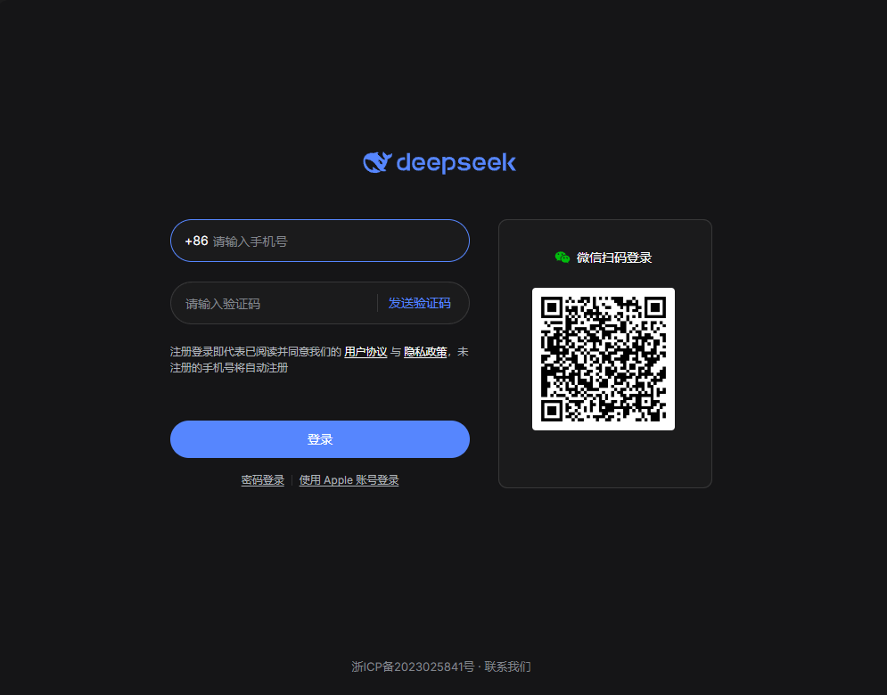
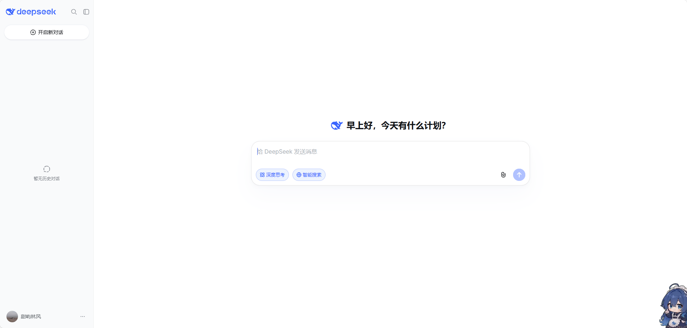

# dsh-plugin-deepseek-chat

English | [中文](README.md)

> **Current version: v1.2.6** | Targets DSH **0.2.2-rc.2**

Adds **DeepSeek Chat** to the **DeepSeek Harness (DSH) desktop**: a sidebar icon entry, a conversation-header tab (default name **DeepSeek Chat**, configurable), and an optional **right-sidebar card** registered through `dsh-better-sidebar` when installed (default name **DeepSeek Chat**, independently configurable). Clicking any of them opens `chat.deepseek.com` filling the conversation area and remembers the last conversation. A **settings page** (with plugin metadata and a "Check for updates" button) lets you show/hide each surface and rename them. The panel is **pure web chat** — no account status strip.

> Repository: [GitHub](https://github.com/sweet560/dsh-plugin-deepseek-chat) | [Gitee mirror](https://gitee.com/wtt520wyl/dsh-plugin-deepseek-chat)





> The image above is the signed-in `chat.deepseek.com` new-chat home ("早上好，今天有什么计划？") as rendered inside the plugin's embedded webview; the image below shows where the panel sits in the DSH desktop app.

## Features

- **Three entries coexist**:
  - A sidebar icon, placed between **Plugins** and **Scheduled tasks**, opening the full main area;
  - A tab in the conversation-header tab row ("Dialogue / Trajectory / Context / Compression / Team / Stats"), registered through the official `conversation.view` slot (`id: deepseek-chat-view`, `order: 100`), **default label "DeepSeek Chat"**;
  - **Right-sidebar card (v1.1.7; dual path since v1.1.9)**: registers a right-sidebar card (`id: @tianyulinfeng1/dsh-plugin-deepseek-chat:card`, `order: 60`, single instance), **default label "DeepSeek Chat"**, reusing the web-chat webview. Since v1.1.9 this is a **dual path**: the only criterion is whether better-sidebar is *actually running* — if so `registerTab`, otherwise (not installed or started late) inject directly into DSH native right sidebar via `sidebarRightTabs`; the paths are mutually exclusive and a late service switches over automatically, so no manual toggle is needed — no dependency or inject declaration changes.
- **Settings page (v1.1.4, four settings in v1.1.7; a 4th "Auto-loop" card in v1.2.0)**: registered through the official `settings.section` slot (a "DeepSeek Chat" page in the Settings dialog). Base settings (header tab and right-sidebar card are independent):
  - **Show header tab** (default on): turning it off removes the header tab, leaving only the sidebar entry;
  - **Header tab name** (default `DeepSeek Chat`): the field is **empty by default** and shows the default name only as a grey placeholder; click into it and type a new name directly (no need to delete the default text first). Empty falls back to the default, capped at 40 characters;
  - **Show right-sidebar card** (v1.1.7, default on): turning it off unregisters the card on the active path (better-sidebar or DSH native right sidebar);
  - **Right-sidebar card name** (v1.1.7, dual path since v1.1.9, default `DeepSeek Chat`): same grey-placeholder behaviour, empty restores the default, capped at 40 characters; `title` is a thunk so renaming takes effect immediately, independent of the header tab name.
  - Settings are persisted in `localStorage` under `dsh-plugin-deepseek-chat:config` (base `showTab` / `tabLabel` / `showCard` / `cardLabel`; v1.2.0 adds `autoSyncEnabled` / `maxAutoLoops` / `errorKeywords` / 4 selector groups) and take effect immediately (tab row / card registered or unregistered; auto-loop follows the switch).
- **About this plugin (v1.1.5)**: the Settings page shows the plugin version, author (`sweet560`), a short description, the open-source license (`MIT`), and two `https` links to the npm package page and the GitHub repository (opened by the desktop shell in the system browser).
- **Check for updates (v1.1.5)**: the Settings page adds a "Check for updates" button that reads the latest published version from two public JSON endpoints — **npm first, GitHub as a fallback** (npm `dist-tags.latest`, `raw.githubusercontent.com` `package.json`). Versions are compared segment-by-segment numerically: up to date / new version available / check failed all produce a text status with npm/GitHub jump links. Repeated clicks are ignored while checking; network failures and both-source failures are handled gracefully. No Host route is added.
- **One-click update (v1.1.10)**: integrated with "Check for updates" — an "Update now" button appears in the result area (the red-boxed spot) only when a new version is found. Clicking it really calls the official DSH Host channel `pluginManager.updateBundle(name, version)` to replace the bundle, and honestly reports "Update complete / Installed — please restart DSH / Update failed: <reason>" in Chinese. `remote` is a `ctx.get` soft read, not added to `inject` (to avoid parking the whole plugin fiber on a cold start); a local `link:` install is refused by the official `updateRefusal`, so the failure is shown as-is with the npm/GitHub manual-update links kept.
- **Conditional auto-loop (v1.2.0, off by default)**: once enabled in Settings, when a desktop turn completes (`turn/end`) the agent's answer is filled into the DeepSeek web input and sent automatically; the plugin waits for the web reply to finish (the stop button appears then disappears), grabs the assistant text, and **writes it only into the desktop draft** (`setDraft`, never `submit`) — whether to click "Continue / Run" is always your decision. "Automatic" covers only transferring and sending; the decision to keep running stays with you. Three safety valves: master switch + max loops, error-keyword circuit breaker, and per-turn deduplication; four selector groups (stop / send / textarea / assistant message) are configurable in Settings. The bidirectional channel uses a `<webview>.executeJavaScript` page bridge plus the official `ctx.get("sessions").binding().eventSource` contract — no DSH core changes and no extra API quota.
- **Half-automatic bring-back (v1.2.1, off by default)**: borrows the **structured parsing** of the official experimental plugin `@deepseek-ai/dsh-deepseek-chat-import` (which parses `export_format_version:3` chat exports instead of scraping the web DOM) to fix the real-world "web reply grab timed out twice at 180s" pain. Channel A still auto-transfers and sends, but after `send ok` the plugin **skips** the DOM stop-button wait / 180s timeout and instead waits explicitly in the status bar for you to paste the web reply (or an official export session JSON). `extractExportReply()` follows `current_message_id` to pick the branch and takes only `RESPONSE` fragments of `FINISHED` replies (skipping `CONTENT_FILTER` / templates / thinking); `bringBackReply()` writes the result **only into the desktop draft** (`setDraft`, never `submit`), fills all four loop-trace stages and `acknowledge()`s back to `idle`. One extra manual paste buys independence from DOM redesigns and timeouts; off by default, zero regression for the v1.2.0 full-auto path, no extra API quota.
- **Auto-send fix (v1.2.2)**: fixes the real-world "text is filled into the web input but never sent automatically". The old implementation wrapped the send-button click / keyboard fallback inside `window.requestAnimationFrame`; when the DeepSeek `<webview>` is hidden or occluded Chromium throttles rAF to 0, so the callback never fires and the text is filled but not sent. v1.2.2 switches to a **synchronous immediate click** + `window.setTimeout` retries at `[120,320,700,1400,2800]ms` (covering React-controlled buttons that enable late) + a generic button scan (`button, [role='button'], [data-testid]` whose label / title / text matches 发送 / 送出 / Send / Submit) + a **plain-Enter-first, then Ctrl+Enter** keyboard fallback; an emptied input box is treated as "really sent" so retries stop. The chosen `method` is written into `lastSendMethod` of the loop trace for real-machine review. The user confirmed "after a manual send the web reply flows back into the desktop draft" = the bring-back chain already works; this release only closes that last gap. DOM grabbing / the three safety valves / `setDraft` (never `submit`) are unchanged.
- **Send confirmation (v1.2.3)**: upgrades "send reported ok" to "confirm the user message really appeared in the web message stream". `fillAndSend` records the user-message node count before sending, then after `SEND_CONFIRM_DELAY=3500ms` reads back `confirm()`: a new user-message node (`via=node`) or an emptied input box (`via=cleared`) means confirmed; if neither happens, it explicitly enters `error(unconfirmed)` and the status bar shows a "Try again" button (`retryPush()` re-sends the last push without incrementing the loop count or re-triggering dedup). New 14th config field `userMessageSelectors` (default `[data-message-author-role="user"]`, configurable in Settings) powers the node count; confirmation results are written to loop-trace `lastSendConfirmed / lastSendConfirmVia / lastSendUserMsgDelta`. Main flow unchanged, never calls `submit()`, zero regression for hand-written bridge stubs.
- **v1.2.3 regression fix (v1.2.4)**: the v1.2.3 send confirmation produced a false negative on the real machine — DeepSeek has no `[data-message-author-role="user"]` node and leaves draft text in the input, so `via=none` called `noteError`, flipping `waiting` → `error` and killing the reply poller (which only lives while `waiting`); the web reply finished but was never grabbed back into the desktop draft. v1.2.4 downgrades confirmation to pure observation (loop-trace only, state untouched); failure reporting is left to the real 180s reply-window timeout. The "Try again" button now appears only on an actual send failure. A new L-section regression guard locks this behavior in.
- **Cross-session cross-talk fix (v1.2.5)**: fixes the real-machine report that "switching to another session made that session's answer get auto-pushed into the web page" plus "switching away from the paired session stops this round from triggering" — two faces of one bug. Root cause: the loop component is registered on the global `conversation.composer.dock`; `makeSyncDock` subscribes to whichever session owns the current composer with no "paired-session-only" filter, and `injectDraft` never checks `dock.sessionId`. v1.2.5 makes the loop **serve only one paired session, locked on the first turn/end**: turn/end from non-paired sessions is dropped at the entry, and `injectDraft` refuses a session mismatch (blocking cross-talk in both directions). Switching away from the paired session → explicit `paused(switched-away)` with a status bar showing "bound to session X / Paused / Rebind", turning "no handoff while switched away" from a silent failure into a visible expected state; switching back auto-resumes (intermediate states return to idle and need a user continue). M-section 9 assertions cover pair locking / session filtering / injection check / switch-away pause / rebind.
- **Loop keeps running after switching sessions (v1.2.6)**: v1.2.5's approach A (pause on switching away) removed cross-talk but meant "no auto-flow after switching sessions". v1.2.6 switches to approach B — the loop keeps following **the session locked on the first turn/end**; switching to another conversation neither stops the subscription nor pulls in other sessions' content. Two key changes: ① **subscription ownership moved up** from the composer dock effect (which used to stop on switching away) to the runtime, targeting `sessions.binding(paired).eventSource` by paired-session id — switching away no longer switches or stops the subscription; ② **session-directed draft injection** uses the official `conversation.input.requestDraftInitialization(binding, {prompt, whenDraftExists:'replace'})` (which DSH itself uses during navigation) to write the web reply into **the paired session's own draft**, never through the current composer, blocking reverse cross-talk; it only falls back to the legacy `setDraft` when that API is unavailable (old DSH / unbound). The status bar now reads "Loop still running in the bound session — reply goes to its draft; switch back to view". Requires that switching sessions is navigation (session A not closed); if A is closed, click "Rebind". N-section 9 assertions cover the session-directed API call / lost binding / reverse cross-talk prevention / moved subscription. See the CHANGELOG 1.2.6 section.
- **Fills the conversation area (v1.1.4)**: while the header tab is selected, the web chat now fills the whole conversation area and covers DSH's own message list and bottom composer. Switching back to "Dialogue" restores them. The header entry uses an opaque absolutely-positioned overlay (`inset: 0`, `z-index: 50`) over the conversation body; the tab row in the header stays above it and remains clickable.
- Both entries **share the same chat component** (the header entry wraps it in the full-area overlay) and the same constant partition `panel:deepseek-chat`, so login state and conversation memory are common to both; switching away from the tab releases the lease and re-entering re-acquires the same partition.
- Full-width embedded `https://chat.deepseek.com/` (Electron `<webview>` through the desktop guest-lease bridge `window.dshDesktop.browser`).
- **Last-conversation memory**: switching panels/sessions or restarting the app reopens the conversation you left, not a new chat.
- Auth pages never overwrite that memory; a dead conversation falls back to the site root.
- **Stable login session (fixed in v1.1.1)**: the guest partition is the constant `panel:deepseek-chat`; switching panels/sessions back no longer rebuilds the partition or asks for a fresh QR scan.
- **Crash containment**: if the embedded page's process dies, is destroyed, or never starts, the panel shows a Retry card — the app window no longer goes blank (fixed in v0.4.0).
- **Pure web chat (v1.1.3)**: the account status strip, account probe, 5-second polling and account-sync store are entirely removed. The panel acquires its lease and starts on mount, with no asynchronous account flow.
- Inert on the plain Web surface (`dsh web`): the site sends `frame-ancestors 'none'`, so an iframe cannot carry it, and the guest bridge only exists in the desktop shell.

> **v1.1.2 web boot crash fix**: v1.1.1 renamed the npm package to the scoped `@tianyulinfeng1/dsh-plugin-deepseek-chat`, but the client-bundle factory id in `lib/client.js` stayed the old short name `dsh-plugin-deepseek-chat`. That mismatch made the DSH Host re-execute the same bundle and throw `duplicate factory registration`, ending in `web boot: 1 entry did not activate` and a failed page boot. v1.1.2 aligns the factory id with the full package name and adds a regression assertion that the factory id must equal `package.json`'s `name`. See [docs/RELEASE_NOTES_v1.1.2.md](docs/RELEASE_NOTES_v1.1.2.md).

> **v1.1.3**: removes the account status display and adds the conversation-header "Web Chat" tab, as requested. The old main / sidebar.panellist injections, previously wrapped in one try/catch, are now three independent try/catch blocks so a single failure no longer suppresses the other entries.

> **v1.1.4**: adds a settings page (show/hide the header tab + a custom tab name, default "DeepSeek Chat"); fixes the header tab not filling the conversation area (DSH's composer was still visible below the web chat). The red-boxed title chip in the user's second screenshot is a chat.deepseek.com page element; per the user's confirmation it is left untouched — the plugin does not modify the third-party page.

> **v1.1.5**: adds an About block to Settings (version / author / description / license / npm & GitHub links) and a "Check for updates" button (npm first, GitHub fallback, numeric semver comparison, text status + jump links, timeout and failure fallback). The empty Host half is untouched.

> **v1.1.6**: a pure OIDC trusted-publishing pipeline test; same features as v1.1.5.

> **v1.1.7**: adds a right-sidebar card following the `dsh-better-sidebar` model (soft `ctx.get('betterSidebar')` probe + `registerTab`, thunk `title` for instant renaming, disposer held by `ctx.effect`), plus a "Show right-sidebar card" switch and a "Right-sidebar card name" field in Settings (default "DeepSeek Chat", independent of the header tab). Zero new dependencies and no inject-declaration changes. See [docs/RELEASE_NOTES_v1.1.7.md](docs/RELEASE_NOTES_v1.1.7.md).

> **v1.1.8**: fixes the right-sidebar card not appearing. v1.1.7 probed `ctx.get("betterSidebar")` once in `apply()` without declaring `inject`; when `dsh-better-sidebar`'s `ctx.provide` ran later, Cordis only woke fibers that *declared* the service, so the soft-probing plugin was never retried and `registerTab` was never called (the card was missing from the "Sidebar content" settings too). v1.1.8 **re-reads the service on every sync with a bounded, cancellable readiness retry** (browser-global timer, cleaned up by `ctx.effect`), so a late provider is picked up automatically; with better-sidebar absent every other surface still works. Target DSH bumped to **0.2.2-rc.2**. See [docs/RELEASE_NOTES_v1.1.8.md](docs/RELEASE_NOTES_v1.1.8.md).

> **v1.1.9**: fixes "after restarting DSH you must toggle the right-sidebar card off and on once before it appears". v1.1.8's bounded 20-second readiness retry expired because better-sidebar's cold start waits for Host transport services before it calls `provide('betterSidebar')`; once that window elapsed the card was never registered. v1.1.9 switches to **service-ready events + an unbounded cancellable fallback + re-reads on every sync** — any of the three registers the card, so no manual toggle is needed. It also adds the requested **dual path**: the only criterion is whether better-sidebar is *actually running* — if so `registerTab`, otherwise (not installed or started late) inject directly into DSH's own native right sidebar via `sidebarRightTabs`; the paths are mutually exclusive and a late service switches over automatically. See [docs/RELEASE_NOTES_v1.1.9.md](docs/RELEASE_NOTES_v1.1.9.md).

> **v1.1.10 (previous release)**: when "Check for updates" finds a new version, an "Update now" button appears in the result area (the red-boxed spot). Clicking it really calls the official DSH Host channel `pluginManager.updateBundle` to replace the bundle, and honestly maps the returned status to "Update complete / Installed — please restart DSH / Update failed: <reason>". `remote` is a `ctx.get` soft read, not added to `inject`; a local `link:` install is refused by the official `updateRefusal`, so the failure is reported as-is with the npm/GitHub manual-update links kept. See [docs/RELEASE_NOTES_v1.1.10.md](docs/RELEASE_NOTES_v1.1.10.md).

> **v1.2.0 (previous release)**: adds the **conditional auto-loop** (off by default) — a completed desktop turn auto-transfers to the web chat and sends, the finished web reply is grabbed and written only into the desktop draft, and whether to continue is always your call; three safety valves (master switch + max loops / error-keyword breaker / per-turn dedup) + four configurable selector groups + an in-panel status bar. Because the host main process strips custom `preload` webPreferences and there is no `dsh-hooks-bus`, the implementation uses the `<webview>.executeJavaScript` page bridge + `sessions.binding().eventSource` (`'turn/end'`) + `InputActions.setDraft()` (never `submit`) official contracts instead. All changes stay inside the plugin boundary; off by default, opt-in when you need it. See the CHANGELOG 1.2.0 section.

> **v1.2.1 (previous release)**: borrows the **structured parsing** of the official experimental plugin `@deepseek-ai/dsh-deepseek-chat-import` (parses `export_format_version:3` chat exports, not the web DOM) and adds a **half-automatic bring-back** mode (off by default), targeting the real-world loop-trace evidence where the web-reply grab timed out twice at 180s. Channel A still auto-transfers and sends, but after `send ok` the plugin **skips** the DOM stop-button wait / 180s timeout and instead waits explicitly in the status bar for you to paste the web reply (or an official export session JSON). `extractExportReply()` follows `current_message_id` to pick the branch and takes only `RESPONSE` fragments of `FINISHED` replies (skipping `CONTENT_FILTER` / templates / thinking); `bringBackReply()` writes the result **only into the desktop draft** (`setDraft`, never `submit`), fills all four loop-trace stages and `acknowledge()`s back to `idle`. One extra manual paste buys independence from DOM redesigns and timeouts; off by default, zero regression for the v1.2.0 full-auto path, no extra API quota. See the CHANGELOG 1.2.1 section.

> **v1.2.2 (this release)**: fixes the real-world "text is filled into the web input but never sent automatically". The root cause: the old implementation wrapped the send-button click / keyboard fallback inside `requestAnimationFrame`; when the DeepSeek `<webview>` is hidden or occluded Chromium throttles rAF to 0, so the callback never fires and the text is filled but not sent. v1.2.2 switches to a **synchronous immediate click** + `window.setTimeout` retries at `[120,320,700,1400,2800]ms` (covering React-controlled buttons that enable late) + a generic button scan + a **plain-Enter-first, then Ctrl+Enter** keyboard fallback; an emptied input box is treated as "really sent" so retries stop. The chosen `method` is written into `lastSendMethod` of the loop trace for real-machine review. The user confirmed "after a manual send the web reply flows back into the desktop draft" = the bring-back chain already works; this release only closes that last gap. DOM grabbing / the three safety valves / `setDraft` (never `submit`) are unchanged. New offline self-check section K (8 decisive assertions, including `rafRuns:false` simulating a hidden renderer that still clicks synchronously) plus H end-to-end / I trace / J half-auto all green: `RESULT: PASS`. See the CHANGELOG 1.2.2 section.

> **v1.2.3 (this release)**: send confirmation — `send ok` does not mean the web page actually submitted the message. v1.2.3 records the user-message node count before `fillAndSend`, then after `SEND_CONFIRM_DELAY=3500ms` reads back `confirm()`: a new user-message node (`via=node`) or an emptied input box (`via=cleared`) means confirmed; if neither happens, it explicitly enters `error(unconfirmed)` and the status bar shows a "Try again" button (`retryPush()` re-sends the last push without incrementing the loop count or re-triggering dedup). Adds the 14th config field `userMessageSelectors` (configurable in Settings); confirmation results go to loop-trace `lastSendConfirmed / lastSendConfirmVia / lastSendUserMsgDelta`. Zero regression: main flow unchanged, no `submit()`, hand-written bridge stubs skip confirmation. New offline self-check section L (10 assertions: node confirmation / emptied-input fallback / failure report / try-again / delayed read-back), all sections A–K `RESULT: PASS`. See the CHANGELOG 1.2.3 section.

> **v1.2.6 (this release)**: loop keeps running after switching sessions (approach B) — the loop keeps following the session locked on the first turn/end; switching conversations neither stops the subscription nor pulls in other sessions' content. Evidence: the official API `conversation.input.requestDraftInitialization` writes drafts to a specified `SessionBinding` without the current composer (DSH itself uses it during navigation). Two changes: ① event subscription moved up from the composer dock effect to the runtime, targeted by paired-session id (switching away no longer switches/stops it); ② draft injection uses that official API to write into the paired session's own draft (falling back to legacy `setDraft` only when unavailable), blocking reverse cross-talk. Status bar: "Loop still running in the bound session — reply goes to its draft; switch back to view". Requires session switching to be navigation (session A not closed), otherwise click "Rebind". N-section 9 assertions cover session-directed API / lost binding / reverse cross-talk prevention / moved subscription. See the CHANGELOG 1.2.6 section.

> **v1.2.5 (previous release)**: fixes cross-session cross-talk — the real-machine "switching to another session made that session's answer get auto-pushed into the web page" plus "switching away from the paired session stops the round" are two faces of one bug (the loop component hangs off the global `conversation.composer.dock`, subscribing to the current composer's session with no session filter, and `injectDraft` never checks `dock.sessionId`). v1.2.5 makes the loop serve **only the session locked on the first turn/end**: non-paired turn/end is dropped at entry, and `injectDraft` refuses a session mismatch (blocking cross-talk both ways). Switching away → `paused(switched-away)` with the status bar showing "bound to session X / Paused / Rebind", making "no handoff" a visible expected state; switching back auto-resumes (intermediate states go to idle and need a user continue). M-section 9 assertions cover pair locking / session filtering / injection check / switch-away pause / rebind. Serving a single session is by design, not a fault. See the CHANGELOG 1.2.5 section.

> **v1.2.4**: fixes the real-machine regression introduced in v1.2.3 — a send-confirmation false negative (`via=none`; DeepSeek has no user-message node and leaves draft text in the input) called `noteError`, flipping `waiting` → `error` and killing the reply poller (which only lives while `waiting`), so the finished web reply was never grabbed back into the desktop draft. v1.2.4 downgrades confirmation to **pure observation** (loop-trace only, state untouched); failure reporting is left to the real 180s reply-window timeout, and the "Try again" button now appears only on an actual send failure. New L-section regression guard asserts state stays `waiting` on a `via=none` false negative. See the CHANGELOG 1.2.4 section.

> **Loop trace & "trigger + observe" verification scripts (v1.2.0 addendum, dev-only)**: with the auto-loop enabled, the plugin writes stage timestamps into `dsh-plugin-deepseek-chat:loop-trace` in `localStorage` (`lastTurnEndAt` / `lastSendResult` / `lastResponseCompleteAt` / `lastDraftInjectedAt` plus a stage event log); **nothing is written while the switch is off**. `test/verify-runtime.cjs` (read-only runtime probe, section G) and `test/verify-loop-runtime.cjs` (zero-dependency "trigger + observe" script) read those four stages back from the desktop `Local Storage/leveldb` through the shared reader `test/lib/read-leveldb.cjs` for objective verification; all three are dev tools and are excluded from the npm package. Honest boundary: there is no `dshx` / `dsh-exec` CLI on this machine (no way to trigger a turn from a script), so the "trigger" step is optional and degrades honestly when missing; the sandboxed renderer has no Node `fs`, so the trace lives in `window.localStorage` rather than a disk JSON file. The scripts can prove "a real TurnEnd fired + the transfer/send/grab/inject action sequence"; the **last centimetre** — whether the draft really appears in the `<webview>` web input and was not auto-executed — still needs a human look (scripts cannot reach the guest DOM).

## Requirements

| Item | Requirement |
|---|---|
| DSH | Desktop `0.2.2-rc.2` or newer |
| Platform | Windows / macOS / Linux desktop shell |
| git | Only for the GitHub install route (pnpm fetches the repository) |

## Install

npm package: **`@tianyulinfeng1/dsh-plugin-deepseek-chat`** (the GitHub repository is still named `dsh-plugin-deepseek-chat`).

### Option 1 — npm (recommended)

```powershell
dsh plugin --profile desktop add @tianyulinfeng1/dsh-plugin-deepseek-chat
```

You can also enter the package name `@tianyulinfeng1/dsh-plugin-deepseek-chat` in the Plugins page.

### Option 2 — Plugins page (GitHub)

1. Open DSH desktop and click **Plugins** in the sidebar.
2. Click **Install a third-party plugin** above the list.
3. Enter:

   ```
   github:sweet560/dsh-plugin-deepseek-chat
   ```

   `https://github.com/sweet560/dsh-plugin-deepseek-chat` works too.
4. Click **Install** and wait for pnpm to finish.
5. The plugin is enabled automatically; **DeepSeek Chat** appears in the sidebar.

### Option 3 — CLI (GitHub)

```powershell
dsh plugin --profile desktop add github:sweet560/dsh-plugin-deepseek-chat
```

Then open **Plugins → Installed plugins** and make sure **DeepSeek Chat** is switched on (the CLI only installs the package).

### Option 4 — local checkout (development)

```powershell
dsh plugin --profile desktop add file:"<absolute path to this repository>"
```

## Why the web chat cannot reuse the DSH sign-in

**A pure plugin cannot make chat.deepseek.com reuse the already-signed-in DSH account.** This is an architecture limit of DSH 0.2.2-rc.1, verified against its source:

| | DSH desktop account | chat.deepseek.com web |
|---|---|---|
| Credential | platform.deepseek.com `x-dsh-auth-token` (Host-only `getPlatformSession()`) | the site's own Token (`api/v0/users/current` returns `40002 Missing Token` without it) |
| Storage | Host credential store | httpOnly cookie in the guest session |
| Exchange | **None** — zero `chat.deepseek.com` references, no SSO, no cookie injection in the whole archive | — |

- The renderer bridge `globalThis.dshDesktop` exposes only `browser.acquire/release/onOpenRequested` etc. — **no** `getAuthToken`, cookie write, or "open Platform to fetch token" API. `getAuthToken()` exists only in the desktop shell's embedded Platform view (`usage` / `top_up`) preload, main-frame + origin restricted.
- The `browserAcquire` IPC only allocates a partition/lease by workspace string; `configureSession()` sets permissions and download interception, **it injects no credentials**. The guest is forced to `sandbox / contextIsolation / webSecurity`.
- So the DSH account and the web session are unrelated; one manual QR sign-in is still required. **Since v1.1.3 even the account-status display is gone** — the panel is pure web chat.

**What went wrong in v1.1.0 (fixed in v1.1.1, account logic removed entirely in v1.1.3)**: the guest partition had been keyed to the asynchronous account probe. DSH's `getState()` can transiently fail during a reconnect or session switch; changing the partition hands the panel a brand-new cookie jar → a fresh QR scan every time you switched back. Now:

- `acquire()`'s workspace is the constant `panel:deepseek-chat`, and the conversation key is the constant `dsh-plugin-deepseek-chat:last-url`;
- no account probe, polling, state subscription or strip participates in the guest lifecycle at all;
- the guest starts on mount immediately, without waiting for any async Remote;
- popup navigation is allowlisted to `chat.deepseek.com` and `platform.deepseek.com` (HTTPS, default port).

> To also avoid re-scanning **after restarting DSH**, run [scripts/patch-dsh-persistent-partition.cjs](scripts/patch-dsh-persistent-partition.cjs) per [docs/login-persistence.md](docs/login-persistence.md) to change DSH's random in-memory partition into a deterministic `persist:` one (an `app.asar` edit — modifying the installed app, at your own risk). **It also syncs the per-file SHA256 ASAR integrity required by 0.2.2-rc.1** — a byte-only replacement (the deprecated `.mjs` script) would crash DSH on restart. It requires fully exiting DSH first. That patch preserves web cookies across restarts; it does not make the web chat reuse the DSH token.

## Usage

- The first visit shows the chat.deepseek.com sign-in page; sign in once.
- Within one app run, switching panels or sessions keeps you signed in (fixed partition since v1.1.1).
- **Sign in again after restarting DSH**: DSH currently gives embedded browsers a random in-memory partition (`dsh-sidebar-browser-<uuid>`, no `persist:` prefix), so cookies are dropped when the process exits. This plugin does not modify DSH's installation files; to sign in once and stay signed in, apply the equal-length byte patch described in **[docs/login-persistence.md](docs/login-persistence.md)**.
- The conversation URL is stored under the fixed key `dsh-plugin-deepseek-chat:last-url`, so the last conversation is restored after a restart (while signed in and while it still exists).
- The header tab (default **"DeepSeek Chat"**), the sidebar icon and the right-sidebar card are the same web chat; switching to another tab unmounts this plugin's guest and releases the lease, and switching back reloads it (same partition, login state and conversation memory preserved).
- **Settings page**: open the DSH **Settings** dialog → "DeepSeek Chat" in the left navigation. Independently toggle **Show header tab** / **Show right-sidebar card** and edit **Header tab name** / **Right-sidebar card name**. Both name fields are empty by default, showing "DeepSeek Chat" only as a grey placeholder; click into one and type directly without deleting any default text. Turning a surface off removes its entry but keeps the sidebar icon; leaving a name empty restores the default "DeepSeek Chat". Settings apply immediately and are stored locally.
- **Right-sidebar card**: requires `dsh-better-sidebar` installed and enabled (0.30.1 on this machine). It appears under Settings → Side cards → "+ Add Tab plugin". With better-sidebar absent the card is not shown and the other entries still work. Its name is a thunk, so renaming updates the card title immediately.
- While the header tab is selected the web chat fills the conversation area and covers DSH's own messages/composer; clicking back to "Dialogue" restores them without losing conversation content.

## Persistent login (optional)

DSH hands embedded browsers an **in-memory partition** (`dsh-sidebar-browser-${randomUUID()}`, no `persist:` prefix), so every app restart drops the cookies. To sign in once and stay signed in, replace that partition with a fixed `persist:` one inside `resources/app.asar` — the two statements are the same length, so the archive can be patched byte-for-byte in place.

Cause, script, verification, rollback and per-platform paths:

**→ [docs/login-persistence.md](docs/login-persistence.md)**

Two plug-and-play batch files ship in `scripts/` with the plugin - no path edits when the plugin is installed on a new computer or DSH lives elsewhere:

- `scripts/一键补丁.bat` - auto-locates DSH, closes it, runs a full `--dry-run` integrity check before patching, and optionally restarts DSH.
- `scripts/回滚.bat` - auto-locates DSH, restores the newest `.bak-*` backup, keeps a `.pre-rollback` copy, rolls back automatically on failure and re-checks with a dry-run.
- `scripts/find-dsh.ps1` - shared path probe (pure ASCII): registry uninstall entries -> running DSH process -> common install roots / drive scan -> walk up from the plugin folder; only if nothing is found does it ask you to drag the DSH folder into the window. It prefers DSH's bundled node, so no separate Node.js install is needed. Both .bat bodies are pure ASCII and work under Chinese (936) or UTF-8 (65001) consoles.

Note: this modifies the installed application and is outside DSH's support; a DSH update overwrites `app.asar` and the patch must be re-applied (the `Partitions` data survives). Back up first and proceed at your own risk.

## Known limitations

- chat.deepseek.com detects the Electron embedding and occasionally shows a "usage environment is abnormal" notice. That is site-side behaviour, unrelated to this plugin.
- Desktop only; `dsh web` in a browser shows no entry.
- If the site changes its conversation URL scheme (currently `/a/chat/s/<id>`), the memory falls back to the site root.
- A pure plugin cannot reuse the DSH token, so the web chat still needs one manual sign-in on first use (see above). **Since v1.1.3 the panel shows no account status at all.**
- Restarting DSH still requires a fresh web sign-in unless the persistent-partition patch in [docs/login-persistence.md](docs/login-persistence.md) is applied.

## Crash containment (v0.4.0)

Earlier versions could leave the whole app a blank window a second or two after opening the panel, with no crash dialog and no `crash-*.log`.

Root cause: React runs effect cleanups after it has removed the DOM, and Electron's `<webview>` throws from `getURL()` once detached. DSH treats any uncaught plugin error as `slot entry crashed in 'root'` and unmounts the root slot — the entire UI.

The current implementation guards every guest call behind an `isConnected` check and `try/catch`, reads the URL before removing the element, wraps every event handler, puts a React error boundary around the panel, listens for `render-process-gone` / `destroyed` / `did-fail-load`, and has a 15-second start watchdog. On failure the dead guest element is removed **before** the Retry card, so retrying cannot stack webviews; a listener-registration failure never starts a guest, and popup URLs are allowlisted (v1.1.0).

## Version history

| Version | Changes |
|---|---|
| **1.2.6** | **Loop keeps running after switching sessions (approach B)**: subscription moved up to the runtime and targeted by paired-session id (switching away no longer switches/stops it); draft injection uses the official `conversation.input.requestDraftInitialization(binding,{prompt,whenDraftExists:'replace'})` to write into the paired session's own draft (falling back to legacy `setDraft` only when unavailable), blocking reverse cross-talk; status bar "Loop still running in the bound session — reply goes to its draft; switch back to view". Requires session switching to be navigation (session A not closed), otherwise click "Rebind". N-section 9 assertions. See the CHANGELOG 1.2.6 section. |
| | **1.2.5** | **Cross-session cross-talk fix**: the loop now serves only the session locked on the first turn/end — non-paired turn/end is dropped at the entry, and `injectDraft` refuses a `dock.sessionId` mismatch (blocking cross-talk both ways); switching away from the paired session → `paused(switched-away)` + status bar "bound to session X / Paused / Rebind", switching back auto-resumes (intermediate states → idle). M-section 9 assertions cover pair locking / session filtering / injection check / switch-away pause / rebind. Serving a single session is by design, not a fault. See the CHANGELOG 1.2.5 section. |
| | **1.2.4** | **Fixes the v1.2.3 real-machine regression**: a send-confirmation false negative (`via=none`; DeepSeek has no user-message node and leaves draft text in the input) called `noteError`, flipping `waiting` → `error` and killing the reply poller (which only lives while `waiting`), so the finished web reply was never grabbed back. v1.2.4 downgrades confirmation to pure observation (loop-trace only, state untouched); failure reporting is left to the real 180s timeout; "Try again" now appears only on an actual send failure. New L-section regression guard. See the CHANGELOG 1.2.4 section. |
| **1.2.3** | **Send confirmation (from "send reported ok" to "confirm the user message really appeared in the web message stream")**: `fillAndSend` records the user-message node count before sending, then after `SEND_CONFIRM_DELAY=3500ms` reads back `confirm()`: a new user-message node (`via=node`) or an emptied input box (`via=cleared`) means confirmed; if neither happens, it explicitly enters `error(unconfirmed)` and the status bar shows a "Try again" button (`retryPush()` re-sends the last push without incrementing the loop count or re-triggering dedup). Adds the 14th config field `userMessageSelectors` (configurable in Settings); confirmation results go to loop-trace `lastSendConfirmed / lastSendConfirmVia / lastSendUserMsgDelta`. Zero regression: main flow unchanged, no `submit()`, hand-written bridge stubs skip confirmation. New offline self-check section L (10 assertions), all A–K `RESULT: PASS`. See the CHANGELOG 1.2.3 section. |
| **1.2.2** | **Auto-send fix (targeting the real-world "text filled into the web input but never sent automatically")**: the old implementation wrapped the send-button click / keyboard fallback inside `requestAnimationFrame`; when the DeepSeek `<webview>` is hidden or occluded Chromium throttles rAF to 0, so the callback never fires → the text is filled but not sent (the two real-world 180s `state:timeout` loop-trace runs came from the web page never starting to generate). v1.2.2 removes rAF and uses a **synchronous immediate click** + `window.setTimeout` retries at `[120,320,700,1400,2800]ms` (covering React-controlled buttons that enable late) + a generic button scan (`button, [role='button'], [data-testid]` whose label / title / text matches 发送 / 送出 / Send / Submit) + a **plain-Enter-first, then Ctrl+Enter** keyboard fallback; an emptied input is treated as "really sent" so retries stop; the chosen `method` is written into `lastSendMethod` of the loop trace for real-machine review. The user confirmed "after a manual send the web reply flows back into the desktop draft" = the bring-back chain already works; this release only closes that last gap. DOM grabbing / the three safety valves / `setDraft` (never `submit`) are unchanged. New offline self-check section K (8 decisive assertions, including `rafRuns:false` simulating a hidden renderer that still clicks synchronously) plus H end-to-end / I trace / J half-auto all green: `RESULT: PASS`. See the CHANGELOG 1.2.2 section. |
| **1.2.1** | **Half-automatic bring-back (borrowed from the official experimental plugin's structured semantics)**: references the just-updated `@deepseek-ai/dsh-deepseek-chat-import` (parses `export_format_version:3` exports rather than scraping the web DOM) and adds `halfAutoEnabled` (off by default). Channel A still auto-transfers and sends; after `send ok` the DOM polling / 180s timeout is skipped, and the user pastes the web reply or an official export session JSON into the status bar. `extractExportReply()` follows `current_message_id` to pick the branch and takes only `FINISHED` `RESPONSE` fragments (skipping `CONTENT_FILTER` / templates / thinking); `bringBackReply()` writes only `setDraft()` into the desktop draft (never `submit`), fills all four trace stages and `acknowledge()`s back to `idle`. Targets two real-world `state:timeout` runs; off by default, zero regression for the v1.2.0 full-auto path. New offline self-check section J (14 assertions: official-JSON branch / plain text / non-FINISHED / skipping DOM polling / draft-only / four trace stages): `RESULT: PASS`. See the CHANGELOG 1.2.1 section. |
| **1.2.0** | **Conditional auto-loop**: a completed desktop `turn/end` → auto-transfer to web chat and send → wait for the stop button to disappear and grab the reply → write only into the desktop draft (`setDraft`, never `submit`) → wait for your decision to continue. Three safety valves (master switch + `maxAutoLoops` / error-keyword breaker / per-turn dedup), four configurable selector groups, an in-panel status bar, a 4th Settings card, `autoSyncEnabled` off by default. Because the main process kills custom `preload` / `ipcRenderer.sendToHost` and there is no `dsh-hooks-bus`, it uses the `<webview>.executeJavaScript` page bridge + `sessions.binding().eventSource` (`'turn/end'`) + `InputActions.setDraft()` official contracts. Offline self-check really runs both channels in a simulated DOM plus every safety valve: `RESULT: PASS`. |
| **1.1.10** | **One-click update in Settings**: integrated with "Check for updates" — the "Update now" button appears only when a new version is found; clicking it really calls the official DSH Host channel `pluginManager.updateBundle(name, version)` and maps `ChangeResult.application` to an honest Chinese status (complete / restart / failure reason). `remote` is a `ctx.get` soft read, not added to `inject`; a local `link:` install is refused by `updateRefusal`, with the npm/GitHub manual-update links kept. New self-check assertions for "button only on found / real updateBundle call + args / applied / restart-required / link: refusal / no channel / fallback links" all pass (`RESULT: PASS`). See [docs/RELEASE_NOTES_v1.1.10.md](docs/RELEASE_NOTES_v1.1.10.md). |
| **1.1.9** | **Fixes "manual toggle needed after restart" + dual-path right-sidebar card**: v1.1.8's bounded "500ms x 40 ~ 20s" retry expired because better-sidebar's cold start waits for Host transport services (`remote` / `remote.session` / `connection`) before its fiber turns active and `ctx.provide('betterSidebar')` runs; after the window elapsed nothing retried — hence the manual off/on toggle after every restart. v1.1.9 uses `ctx.on('internal/service', {global:true})` service-ready events + an unbounded cancellable 500ms fallback + re-reads on every sync (any of the three registers). It also adds the requested **dual path**: the only criterion is whether `ctx.get('betterSidebar')` is usable ("actually running") — if so better-sidebar `registerTab`, otherwise (not installed / started late) inject into DSH's native `sidebarRightTabs` (type + `sidebar.right.pane.tab` body slot); mutually exclusive, a late service switches over automatically. New self-check assertions for "both services absent / mutual exclusion / native contract / event switchover / unbounded timer / cleanup" all pass (`RESULT: PASS`). See [docs/RELEASE_NOTES_v1.1.9.md](docs/RELEASE_NOTES_v1.1.9.md). |
| **1.1.8** | **Fixes the right-sidebar card load-order race + targets DSH 0.2.2-rc.2**: v1.1.7 probed `ctx.get("betterSidebar")` once in `apply()` without declaring `inject`; when `dsh-better-sidebar`'s `ctx.provide` ran later, Cordis only woke fibers that declared the service, so the soft-probing plugin was never retried and `registerTab` was never called (the card was also missing from the "Sidebar content" settings). v1.1.8 **re-reads the service on every sync with a bounded, cancellable readiness retry** (browser-global timer, cleaned up by `ctx.effect`), so a late provider is picked up automatically; with better-sidebar absent every other surface still works. Target DSH bumped to `0.2.2-rc.2` (crash-log quotes and old release notes keep rc.1). New self-check assertions for "late service registers / retry is bounded / cleanup cancels timer"; passes fully (`RESULT: PASS`). See [docs/RELEASE_NOTES_v1.1.8.md](docs/RELEASE_NOTES_v1.1.8.md). |
| **1.1.7** | **Adds a right-sidebar card (dsh-better-sidebar)**: soft `ctx.get('betterSidebar')` probe + `registerTab` (`id: @tianyulinfeng1/dsh-plugin-deepseek-chat:card`, `order: 60`, single instance, reuses the web-chat webview), thunk `title` for instant renaming, disposer held by `ctx.effect`; Settings gains a "Show right-sidebar card" switch and a "Right-sidebar card name" field (default "DeepSeek Chat", independent of the header tab). Zero new dependencies, no inject-declaration changes. Offline self-check passes fully (`RESULT: PASS`). See [docs/RELEASE_NOTES_v1.1.7.md](docs/RELEASE_NOTES_v1.1.7.md). |
| **1.1.6** | **OIDC trusted-publishing pipeline test**: `.github/workflows/publish.yml` now enables `permissions.id-token: write`, Node 24 (Active LTS), `npm@latest`, `npm publish --provenance`, and removes `NODE_AUTH_TOKEN` and the `environment` declaration. Version bumped to `1.1.6` and pushed to GitHub to test whether GitHub Actions can publish via npm Trusted Publisher. No functional change from 1.1.5. |
| **1.1.5** | **Adds About info + Check for updates to Settings**: plugin version / author / description / license / npm & GitHub links, plus a "Check for updates" button (npm `dist-tags` first, GitHub `raw` fallback, numeric segment-by-segment version comparison, text status + jump links, 8-second timeout and failure fallbacks). Metadata constants are asserted equal to `package.json`; offline self-check passes fully (`RESULT: PASS`). |
| **1.1.4** | **Adds a settings page + makes the header tab configurable + fills the conversation area**: a `settings.section` page (show/hide header tab, custom tab name default "DeepSeek Chat", localStorage persistence, immediate re-registration for the tab row); the header entry uses an opaque absolute overlay to fill the conversation body and cover the composer. The red-boxed in-page title chip is left untouched per user confirmation. Four slot registrations, offline self-check passes fully (`RESULT: PASS`). |
| **1.1.3** | **Removes the account status display + adds a conversation-header tab**: deletes the account status strip, probe, 5-second polling and account-sync store; adds a `conversation.view` "Web Chat" header tab sharing the component and fixed partition with the sidebar/full-area entries; three slot registrations now use independent try/catch blocks. Offline self-check passes fully (`RESULT: PASS`). |
| **1.1.2** | **Fixes the v1.1.1 web boot crash (highlight)**: the client-bundle factory id did not match the npm package name, so DSH re-executed the same bundle, threw `duplicate factory registration`, and failed with `1 entry did not activate` — the whole page would not boot. The factory id in `lib/client.js` is now aligned to `@tianyulinfeng1/dsh-plugin-deepseek-chat`, with a new regression assertion that it must equal `package.json`'s `name`; 35/35 offline checks pass and all 30 client bundles scan with 0 mismatches. See [docs/RELEASE_NOTES_v1.1.2.md](docs/RELEASE_NOTES_v1.1.2.md). |
| **1.1.1** | **Fixes the "scan the QR code again on every panel switch" regression**: the guest partition and conversation key are constants; account state is display-only and never touches the guest lifecycle; a transient `unknown` is ignored; the guest no longer waits for the async probe; self-check now asserts a fixed partition and no rebuild on state churn (35 cases). Documents why a pure plugin cannot reuse the DSH token. |
| 1.1.0 | DSH `0.2.2-rc.1`: DSH account status strip; correct generated Remote envelope parsing; stricter conversation and popup URL validation; dead guest removal on failure. **This release keyed the partition to account state and broke login persistence (fixed in 1.1.1).** |
| 1.0.0 | First local release: sidebar entry, full-width chat, conversation memory, crash containment. |

## Development

```powershell
git clone https://github.com/sweet560/dsh-plugin-deepseek-chat.git
cd dsh-plugin-deepseek-chat
node test/check-client.mjs
```

`test/check-client.mjs` loads `lib/client.js` in a `node:vm` sandbox with fake React/DOM/bridge objects and checks four slot registrations (sidebar / full-area panel / header tab / settings page), the **right-sidebar card dual path** (better-sidebar `registerTab` when the service is running, otherwise DSH native `sidebarRightTabs` injection; zero cards when both services are absent, mutually exclusive paths, late-service `internal/service` switchover, unbounded cancellable fallback timer, thunk renaming, switch unregister/re-register, effect cleanup unregistration plus listener/timer removal), the config layer (four settings: defaults, type validation, persistence, subscription, dynamic re-injection), the header overlay's fill styling, factory id equals package name, Web-surface inertness, shared fixed partition across both entries, pure web chat with no account strip, URL allowlisting, conversation memory, lease release, popup allowlisting and crash containment; a mock fetch verifies metadata constants against `package.json`, semver comparison, update-payload parsing, npm/GitHub fallback, all update-state branches, and the Settings-page click flow; a fake pluginManager.updateBundle verifies the real call of the one-click update, success / restart / failure states, and fallback links.

```
lib/index.js           host half (empty; it only gives the client bundle a Loader entry)
lib/client.js          browser half: entries, web-chat panel, full-area header overlay, right-sidebar card (dual path: better-sidebar / DSH native right sidebar), settings page + config layer, about info / check-for-updates / one-click update, webview lifecycle, crash containment
cordis.patch.yml       bundle patch that inserts this plugin's Loader row
locale/{zh,en}.json    Plugins-page title/description
icon.svg               Plugins-page icon
docs/login-persistence.md  optional byte patch for DSH's in-memory browser partition (incl. one-click scripts)
scripts/find-dsh.ps1       shared path probe for the one-click scripts (auto-locates app.asar / DSH.exe / bundled node)
scripts/一键补丁.bat        one-click persistent-partition patch (no path edits, ships with the plugin)
scripts/回滚.bat            one-click rollback to the newest backup (keeps a copy / auto-reverts)
scripts/patch-dsh-persistent-partition.cjs  low-level byte patch (--dry-run / full integrity check / idempotent)
test/check-client.mjs  offline self-check
```

## Uninstall

```powershell
dsh plugin --profile desktop remove @tianyulinfeng1/dsh-plugin-deepseek-chat
```

## License

[MIT](LICENSE)
