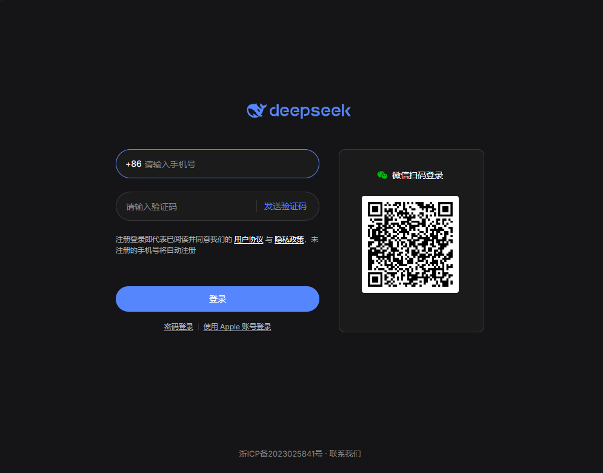

# dsh-plugin-deepseek-chat

English | [中文](README.md)

Adds a **DeepSeek Chat** entry to the **DeepSeek Harness (DSH) desktop** sidebar. Clicking it opens `chat.deepseek.com` full-width in the main area and remembers the last conversation.

> Repository: [GitHub](https://github.com/sweet560/dsh-plugin-deepseek-chat) | [Gitee mirror](https://gitee.com/wtt520wyl/dsh-plugin-deepseek-chat)



## Features

- Sidebar icon entry, placed between **Plugins** and **Scheduled tasks**.
- Full-width embedded `https://chat.deepseek.com/` (Electron `<webview>` through the desktop guest-lease bridge `window.dshDesktop.browser`).
- **Last-conversation memory**: switching panels/sessions or restarting the app reopens the conversation you left, not a new chat.
- Auth pages never overwrite that memory; a dead conversation falls back to the site root.
- **Crash containment**: if the embedded page's process dies, is destroyed, or never starts, the panel shows a Retry card — the app window no longer goes blank (fixed in v0.4.0).
- Inert on the plain Web surface (`dsh web`): the site sends `frame-ancestors 'none'`, so an iframe cannot carry it, and the guest bridge only exists in the desktop shell.

## Requirements

| Item | Requirement |
|---|---|
| DSH | Desktop `0.2.1-rc.2` or newer |
| Platform | Windows / macOS / Linux desktop shell |
| git | Only for the GitHub install route (pnpm fetches the repository) |

## Install

### Option 1 — Plugins page (recommended)

1. Open DSH desktop and click **Plugins** in the sidebar.
2. Click **Install a third-party plugin** above the list.
3. Enter:

   ```
   github:sweet560/dsh-plugin-deepseek-chat
   ```

   `https://github.com/sweet560/dsh-plugin-deepseek-chat` works too.
4. Click **Install** and wait for pnpm to finish.
5. The plugin is enabled automatically; **DeepSeek Chat** appears in the sidebar.

### Option 2 — CLI

```powershell
dsh plugin --profile desktop add github:sweet560/dsh-plugin-deepseek-chat
```

Then open **Plugins → Installed plugins** and make sure **DeepSeek Chat** is switched on (the CLI only installs the package).

### Option 3 — local checkout (development)

```powershell
dsh plugin --profile desktop add file:"<absolute path to this repository>"
```

## Usage

- The first visit shows the chat.deepseek.com sign-in page; sign in once.
- Within one app run, switching panels or sessions keeps you signed in.
- **Sign in again after restarting DSH**: DSH currently gives embedded browsers an in-memory partition (`dsh-sidebar-browser-<uuid>`, no `persist:` prefix), so cookies are dropped when the process exits. This plugin does not modify DSH's installation files, so it cannot bypass that. To sign in once and stay signed in, apply the equal-length byte patch described in **[docs/login-persistence.md](docs/login-persistence.md)** (script, verification and rollback included).
- The conversation URL is stored in the app's localStorage (`dsh-plugin-deepseek-chat:last-url`), so the last conversation is restored after a restart (while signed in and while it still exists).

## Persistent login (optional)

DSH hands embedded browsers an **in-memory partition** (`dsh-sidebar-browser-${randomUUID()}`, no `persist:` prefix), so every app restart drops the cookies. To sign in once and stay signed in, replace that partition with a fixed `persist:` one inside `resources/app.asar` — the two statements are the same length, so the archive can be patched byte-for-byte in place.

Cause, script, verification, rollback and per-platform paths:

**→ [docs/login-persistence.md](docs/login-persistence.md)**

Note: this modifies the installed application and is outside DSH's support; a DSH update overwrites `app.asar` and the patch must be re-applied (the `Partitions` data survives). Back up first and proceed at your own risk.

## Known limitations

- chat.deepseek.com detects the Electron embedding and occasionally shows a "usage environment is abnormal" notice. That is site-side behaviour, unrelated to this plugin.
- Desktop only; `dsh web` in a browser shows no entry.
- If the site changes its conversation URL scheme (currently `/a/chat/s/<id>`), the memory falls back to the site root.

## Crash containment (v0.4.0)

Earlier versions could leave the whole app a blank window a second or two after opening the panel, with no crash dialog and no `crash-*.log`.

Root cause: React runs effect cleanups after it has removed the DOM, and Electron's `<webview>` throws from `getURL()` once detached. DSH treats any uncaught plugin error as `slot entry crashed in 'root'` and unmounts the root slot — the entire UI.

The current implementation guards every guest call behind an `isConnected` check and `try/catch`, reads the URL before removing the element, wraps every event handler, puts a React error boundary around the panel, listens for `render-process-gone` / `destroyed` / `did-fail-load`, and has a 15-second start watchdog.

## Development

```powershell
git clone https://github.com/sweet560/dsh-plugin-deepseek-chat.git
cd dsh-plugin-deepseek-chat
node test/check-client.mjs
```

`test/check-client.mjs` loads `lib/client.js` in a `node:vm` sandbox with fake React/DOM/bridge objects and checks registration, conversation memory, lease release, and crash containment.

```
lib/index.js           host half (empty; it only gives the client bundle a Loader entry)
lib/client.js          browser half: entry, panel, webview lifecycle, crash containment
cordis.patch.yml       bundle patch that inserts this plugin's Loader row
locale/{zh,en}.json    Plugins-page title/description
icon.svg               Plugins-page icon
test/check-client.mjs  offline self-check
```

## Uninstall

```powershell
dsh plugin --profile desktop remove dsh-plugin-deepseek-chat
```

## License

[MIT](LICENSE)
