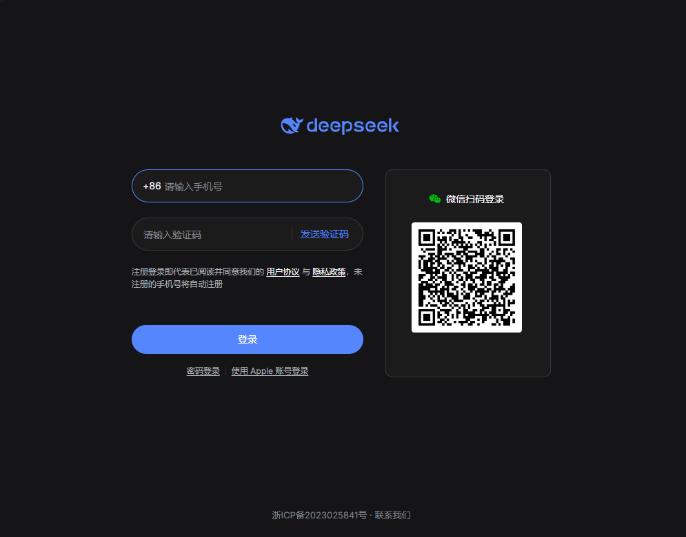

# dsh-plugin-deepseek-chat

English | [中文](README.md)

> **Current version: v1.1.6** | Targets DSH **0.2.2-rc.1**

Adds **DeepSeek Chat** to the **DeepSeek Harness (DSH) desktop**: a sidebar icon entry and a conversation-header tab (default name **DeepSeek Chat**, configurable). Clicking either opens `chat.deepseek.com` filling the conversation area and remembers the last conversation. A **settings page** (with plugin metadata and a "Check for updates" button) lets you show/hide the header tab and rename it. The panel is **pure web chat** — no account status strip.

> Repository: [GitHub](https://github.com/sweet560/dsh-plugin-deepseek-chat) | [Gitee mirror](https://gitee.com/wtt520wyl/dsh-plugin-deepseek-chat)



## Features

- **Two entries coexist**:
  - A sidebar icon, placed between **Plugins** and **Scheduled tasks**, opening the full main area;
  - A tab in the conversation-header tab row ("Dialogue / Trajectory / Context / Compression / Team / Stats"), registered through the official `conversation.view` slot (`id: deepseek-chat-view`, `order: 100`), **default label "DeepSeek Chat"**.
- **Settings page (v1.1.4)**: registered through the official `settings.section` slot (a "DeepSeek Chat" page in the Settings dialog). Two settings:
  - **Show header tab** (default on): turning it off removes the header tab, leaving only the sidebar entry;
  - **Header tab name** (default `DeepSeek Chat`): the field is **empty by default** and shows the default name only as a grey placeholder; click into it and type a new name directly (no need to delete the default text first). Empty falls back to the default, capped at 40 characters.
  - Settings are persisted in `localStorage` under `dsh-plugin-deepseek-chat:config` and take effect immediately (the tab row re-registers).
- **About this plugin (v1.1.5)**: the Settings page shows the plugin version, author (`sweet560`), a short description, the open-source license (`MIT`), and two `https` links to the npm package page and the GitHub repository (opened by the desktop shell in the system browser).
- **Check for updates (v1.1.5)**: the Settings page adds a "Check for updates" button that reads the latest published version from two public JSON endpoints — **npm first, GitHub as a fallback** (npm `dist-tags.latest`, `raw.githubusercontent.com` `package.json`). Versions are compared segment-by-segment numerically: up to date / new version available / check failed all produce a text status with npm/GitHub jump links. Repeated clicks are ignored while checking; network failures and both-source failures are handled gracefully. No Host route is added.
- **Fills the conversation area (v1.1.4)**: while the header tab is selected, the web chat now fills the whole conversation area and covers DSH's own message list and bottom composer. Switching back to "Dialogue" restores them. The header entry uses an opaque absolutely-positioned overlay (`inset: 0`, `z-index: 50`) over the conversation body; the tab row in the header stays above it and remains clickable.
- Both entries **share the same chat component** (the header entry wraps it in the full-area overlay) and the same constant partition `panel:deepseek-chat`, so login state and conversation memory are common to both; switching away from the tab releases the lease and re-entering re-acquires the same partition.
- Full-width embedded `https://chat.deepseek.com/` (Electron `<webview>` through the desktop guest-lease bridge `window.dshDesktop.browser`).
- **Last-conversation memory**: switching panels/sessions or restarting the app reopens the conversation you left, not a new chat.
- Auth pages never overwrite that memory; a dead conversation falls back to the site root.
- **Stable login session (fixed in v1.1.1)**: the guest partition is the constant `panel:deepseek-chat`; switching panels/sessions back no longer rebuilds the partition or asks for a fresh QR scan.
- **Crash containment**: if the embedded page's process dies, is destroyed, or never starts, the panel shows a Retry card — the app window no longer goes blank (fixed in v0.4.0).
- **Pure web chat (v1.1.3)**: the account status strip, account probe, 5-second polling and account-sync store are entirely removed. The panel acquires its lease and starts on mount, with no asynchronous account flow.
- Inert on the plain Web surface (`dsh web`): the site sends `frame-ancestors 'none'`, so an iframe cannot carry it, and the guest bridge only exists in the desktop shell.

> **v1.1.2 web boot crash fix**: v1.1.1 renamed the npm package to the scoped `@tianyulinfeng1/dsh-plugin-deepseek-chat`, but the client-bundle factory id in `lib/client.js` stayed the old short name `dsh-plugin-deepseek-chat`. That mismatch made the DSH Host re-execute the same bundle and throw `duplicate factory registration`, ending in `web boot: 1 entry did not activate` and a failed page boot. v1.1.2 aligns the factory id with the full package name and adds a regression assertion that the factory id must equal `package.json`'s `name`. See [docs/RELEASE_NOTES_v1.1.2.md](docs/RELEASE_NOTES_v1.1.2.md).

> **v1.1.3**: removes the account status display and adds the conversation-header "Web Chat" tab, as requested. The old main / sidebar.panellist injections, previously wrapped in one try/catch, are now three independent try/catch blocks so a single failure no longer suppresses the other entries.

> **v1.1.4**: adds a settings page (show/hide the header tab + a custom tab name, default "DeepSeek Chat"); fixes the header tab not filling the conversation area (DSH's composer was still visible below the web chat). The red-boxed title chip in the user's second screenshot is a chat.deepseek.com page element; per the user's confirmation it is left untouched — the plugin does not modify the third-party page.

> **v1.1.5 (this release)**: adds an About block to Settings (version / author / description / license / npm & GitHub links) and a "Check for updates" button (npm first, GitHub fallback, numeric semver comparison, text status + jump links, timeout and failure fallback). The empty Host half is untouched.

## Requirements

| Item | Requirement |
|---|---|
| DSH | Desktop `0.2.2-rc.1` or newer |
| Platform | Windows / macOS / Linux desktop shell |
| git | Only for the GitHub install route (pnpm fetches the repository) |

## Install

npm package: **`@tianyulinfeng1/dsh-plugin-deepseek-chat`** (the GitHub repository is still named `dsh-plugin-deepseek-chat`).

### Option 1 — npm (recommended)

```powershell
dsh plugin --profile desktop add @tianyulinfeng1/dsh-plugin-deepseek-chat
```

You can also enter the package name `@tianyulinfeng1/dsh-plugin-deepseek-chat` in the Plugins page.

### Option 2 — Plugins page (GitHub)

1. Open DSH desktop and click **Plugins** in the sidebar.
2. Click **Install a third-party plugin** above the list.
3. Enter:

   ```
   github:sweet560/dsh-plugin-deepseek-chat
   ```

   `https://github.com/sweet560/dsh-plugin-deepseek-chat` works too.
4. Click **Install** and wait for pnpm to finish.
5. The plugin is enabled automatically; **DeepSeek Chat** appears in the sidebar.

### Option 3 — CLI (GitHub)

```powershell
dsh plugin --profile desktop add github:sweet560/dsh-plugin-deepseek-chat
```

Then open **Plugins → Installed plugins** and make sure **DeepSeek Chat** is switched on (the CLI only installs the package).

### Option 4 — local checkout (development)

```powershell
dsh plugin --profile desktop add file:"<absolute path to this repository>"
```

## Why the web chat cannot reuse the DSH sign-in

**A pure plugin cannot make chat.deepseek.com reuse the already-signed-in DSH account.** This is an architecture limit of DSH 0.2.2-rc.1, verified against its source:

| | DSH desktop account | chat.deepseek.com web |
|---|---|---|
| Credential | platform.deepseek.com `x-dsh-auth-token` (Host-only `getPlatformSession()`) | the site's own Token (`api/v0/users/current` returns `40002 Missing Token` without it) |
| Storage | Host credential store | httpOnly cookie in the guest session |
| Exchange | **None** — zero `chat.deepseek.com` references, no SSO, no cookie injection in the whole archive | — |

- The renderer bridge `globalThis.dshDesktop` exposes only `browser.acquire/release/onOpenRequested` etc. — **no** `getAuthToken`, cookie write, or "open Platform to fetch token" API. `getAuthToken()` exists only in the desktop shell's embedded Platform view (`usage` / `top_up`) preload, main-frame + origin restricted.
- The `browserAcquire` IPC only allocates a partition/lease by workspace string; `configureSession()` sets permissions and download interception, **it injects no credentials**. The guest is forced to `sandbox / contextIsolation / webSecurity`.
- So the DSH account and the web session are unrelated; one manual QR sign-in is still required. **Since v1.1.3 even the account-status display is gone** — the panel is pure web chat.

**What went wrong in v1.1.0 (fixed in v1.1.1, account logic removed entirely in v1.1.3)**: the guest partition had been keyed to the asynchronous account probe. DSH's `getState()` can transiently fail during a reconnect or session switch; changing the partition hands the panel a brand-new cookie jar → a fresh QR scan every time you switched back. Now:

- `acquire()`'s workspace is the constant `panel:deepseek-chat`, and the conversation key is the constant `dsh-plugin-deepseek-chat:last-url`;
- no account probe, polling, state subscription or strip participates in the guest lifecycle at all;
- the guest starts on mount immediately, without waiting for any async Remote;
- popup navigation is allowlisted to `chat.deepseek.com` and `platform.deepseek.com` (HTTPS, default port).

> To also avoid re-scanning **after restarting DSH**, run [scripts/patch-dsh-persistent-partition.cjs](scripts/patch-dsh-persistent-partition.cjs) per [docs/login-persistence.md](docs/login-persistence.md) to change DSH's random in-memory partition into a deterministic `persist:` one (an `app.asar` edit — modifying the installed app, at your own risk). **It also syncs the per-file SHA256 ASAR integrity required by 0.2.2-rc.1** — a byte-only replacement (the deprecated `.mjs` script) would crash DSH on restart. It requires fully exiting DSH first. That patch preserves web cookies across restarts; it does not make the web chat reuse the DSH token.

## Usage

- The first visit shows the chat.deepseek.com sign-in page; sign in once.
- Within one app run, switching panels or sessions keeps you signed in (fixed partition since v1.1.1).
- **Sign in again after restarting DSH**: DSH currently gives embedded browsers a random in-memory partition (`dsh-sidebar-browser-<uuid>`, no `persist:` prefix), so cookies are dropped when the process exits. This plugin does not modify DSH's installation files; to sign in once and stay signed in, apply the equal-length byte patch described in **[docs/login-persistence.md](docs/login-persistence.md)**.
- The conversation URL is stored under the fixed key `dsh-plugin-deepseek-chat:last-url`, so the last conversation is restored after a restart (while signed in and while it still exists).
- The header tab (default **"DeepSeek Chat"**) and the sidebar icon are the same web chat; switching to another tab unmounts this plugin's guest and releases the lease, and switching back reloads it (same partition, login state and conversation memory preserved).
- **Settings page**: open the DSH **Settings** dialog → "DeepSeek Chat" in the left navigation. Toggle **Show header tab** and edit **Header tab name**. The name field is empty by default, showing "DeepSeek Chat" only as a grey placeholder; click into it and type directly without deleting any default text. Turning the tab off removes the header entry but keeps the sidebar icon; leaving the name empty restores the default "DeepSeek Chat". Settings apply immediately and are stored locally.
- While the header tab is selected the web chat fills the conversation area and covers DSH's own messages/composer; clicking back to "Dialogue" restores them without losing conversation content.

## Persistent login (optional)

DSH hands embedded browsers an **in-memory partition** (`dsh-sidebar-browser-${randomUUID()}`, no `persist:` prefix), so every app restart drops the cookies. To sign in once and stay signed in, replace that partition with a fixed `persist:` one inside `resources/app.asar` — the two statements are the same length, so the archive can be patched byte-for-byte in place.

Cause, script, verification, rollback and per-platform paths:

**→ [docs/login-persistence.md](docs/login-persistence.md)**

Note: this modifies the installed application and is outside DSH's support; a DSH update overwrites `app.asar` and the patch must be re-applied (the `Partitions` data survives). Back up first and proceed at your own risk.

## Known limitations

- chat.deepseek.com detects the Electron embedding and occasionally shows a "usage environment is abnormal" notice. That is site-side behaviour, unrelated to this plugin.
- Desktop only; `dsh web` in a browser shows no entry.
- If the site changes its conversation URL scheme (currently `/a/chat/s/<id>`), the memory falls back to the site root.
- A pure plugin cannot reuse the DSH token, so the web chat still needs one manual sign-in on first use (see above). **Since v1.1.3 the panel shows no account status at all.**
- Restarting DSH still requires a fresh web sign-in unless the persistent-partition patch in [docs/login-persistence.md](docs/login-persistence.md) is applied.

## Crash containment (v0.4.0)

Earlier versions could leave the whole app a blank window a second or two after opening the panel, with no crash dialog and no `crash-*.log`.

Root cause: React runs effect cleanups after it has removed the DOM, and Electron's `<webview>` throws from `getURL()` once detached. DSH treats any uncaught plugin error as `slot entry crashed in 'root'` and unmounts the root slot — the entire UI.

The current implementation guards every guest call behind an `isConnected` check and `try/catch`, reads the URL before removing the element, wraps every event handler, puts a React error boundary around the panel, listens for `render-process-gone` / `destroyed` / `did-fail-load`, and has a 15-second start watchdog. On failure the dead guest element is removed **before** the Retry card, so retrying cannot stack webviews; a listener-registration failure never starts a guest, and popup URLs are allowlisted (v1.1.0).

## Version history

| Version | Changes |
|---|---|
| **1.1.6** | **OIDC trusted-publishing pipeline test**: `.github/workflows/publish.yml` now enables `permissions.id-token: write`, Node 22, `npm@latest`, `npm publish --provenance`, and removes `NODE_AUTH_TOKEN` and the `environment` declaration. Version bumped to `1.1.6` and pushed to GitHub to test whether GitHub Actions can publish via npm Trusted Publisher. No functional change from 1.1.5. |
| **1.1.5** | **Adds About info + Check for updates to Settings**: plugin version / author / description / license / npm & GitHub links, plus a "Check for updates" button (npm `dist-tags` first, GitHub `raw` fallback, numeric segment-by-segment version comparison, text status + jump links, 8-second timeout and failure fallbacks). Metadata constants are asserted equal to `package.json`; offline self-check passes fully (`RESULT: PASS`). |
| **1.1.4** | **Adds a settings page + makes the header tab configurable + fills the conversation area**: a `settings.section` page (show/hide header tab, custom tab name default "DeepSeek Chat", localStorage persistence, immediate re-registration for the tab row); the header entry uses an opaque absolute overlay to fill the conversation body and cover the composer. The red-boxed in-page title chip is left untouched per user confirmation. Four slot registrations, offline self-check passes fully (`RESULT: PASS`). |
| **1.1.3** | **Removes the account status display + adds a conversation-header tab**: deletes the account status strip, probe, 5-second polling and account-sync store; adds a `conversation.view` "Web Chat" header tab sharing the component and fixed partition with the sidebar/full-area entries; three slot registrations now use independent try/catch blocks. Offline self-check passes fully (`RESULT: PASS`). |
| **1.1.2** | **Fixes the v1.1.1 web boot crash (highlight)**: the client-bundle factory id did not match the npm package name, so DSH re-executed the same bundle, threw `duplicate factory registration`, and failed with `1 entry did not activate` — the whole page would not boot. The factory id in `lib/client.js` is now aligned to `@tianyulinfeng1/dsh-plugin-deepseek-chat`, with a new regression assertion that it must equal `package.json`'s `name`; 35/35 offline checks pass and all 30 client bundles scan with 0 mismatches. See [docs/RELEASE_NOTES_v1.1.2.md](docs/RELEASE_NOTES_v1.1.2.md). |
| **1.1.1** | **Fixes the "scan the QR code again on every panel switch" regression**: the guest partition and conversation key are constants; account state is display-only and never touches the guest lifecycle; a transient `unknown` is ignored; the guest no longer waits for the async probe; self-check now asserts a fixed partition and no rebuild on state churn (35 cases). Documents why a pure plugin cannot reuse the DSH token. |
| 1.1.0 | DSH `0.2.2-rc.1`: DSH account status strip; correct generated Remote envelope parsing; stricter conversation and popup URL validation; dead guest removal on failure. **This release keyed the partition to account state and broke login persistence (fixed in 1.1.1).** |
| 1.0.0 | First local release: sidebar entry, full-width chat, conversation memory, crash containment. |

## Development

```powershell
git clone https://github.com/sweet560/dsh-plugin-deepseek-chat.git
cd dsh-plugin-deepseek-chat
node test/check-client.mjs
```

`test/check-client.mjs` loads `lib/client.js` in a `node:vm` sandbox with fake React/DOM/bridge objects and checks four slot registrations (sidebar / full-area panel / header tab / settings page), the config layer (defaults, type validation, persistence, subscription, dynamic re-injection), the header overlay's fill styling, factory id equals package name, Web-surface inertness, shared fixed partition across both entries, pure web chat with no account strip, URL allowlisting, conversation memory, lease release, popup allowlisting and crash containment; a mock fetch verifies metadata constants against `package.json`, semver comparison, update-payload parsing, npm/GitHub fallback, all update-state branches, and the Settings-page click flow.

```
lib/index.js           host half (empty; it only gives the client bundle a Loader entry)
lib/client.js          browser half: entries, web-chat panel, full-area header overlay, settings page + config layer, about info / check-for-updates, webview lifecycle, crash containment
cordis.patch.yml       bundle patch that inserts this plugin's Loader row
locale/{zh,en}.json    Plugins-page title/description
icon.svg               Plugins-page icon
docs/login-persistence.md  optional byte patch for DSH's in-memory browser partition
test/check-client.mjs  offline self-check
```

## Uninstall

```powershell
dsh plugin --profile desktop remove @tianyulinfeng1/dsh-plugin-deepseek-chat
```

## License

[MIT](LICENSE)
