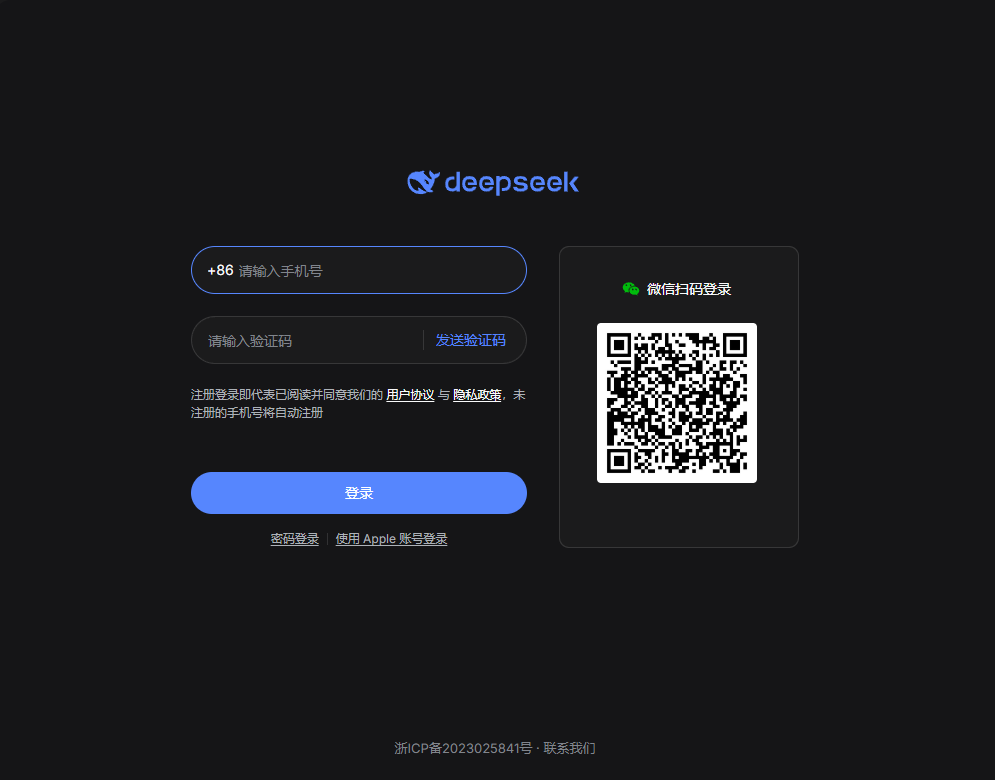
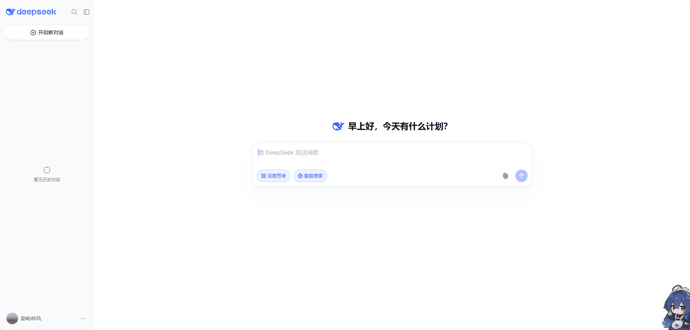

# dsh-plugin-deepseek-chat

[English](README.en.md) | 中文

> **当前版本：v1.1.7** ｜适配 DSH **0.2.2-rc.1**

在 **DeepSeek Harness（DSH）桌面版**加入 **DeepSeek 聊天**：左侧栏图标入口、会话顶栏标签页（默认名「DeepSeek 聊天」，可在设置页开关 / 自定义），以及通过 **dsh-better-sidebar**（若已安装）注册的**右边栏卡片**（默认名「DeepSeek 聊天」，独立开关 / 自定义），点开后 `chat.deepseek.com` 铺满会话区，记住上次所在的会话；提供**设置页面**（含插件基础信息与「检查更新」按钮），面板为**纯网页聊天**，不显示账号状态。

> 仓库：[GitHub](https://github.com/sweet560/dsh-plugin-deepseek-chat) ｜ [Gitee 镜像](https://gitee.com/wtt520wyl/dsh-plugin-deepseek-chat)





> 上图为 `chat.deepseek.com` 已登录后的新对话首页（「早上好，今天有什么计划？」），即插件内嵌网页的实际呈现；下图为插件在 DSH 桌面版里的面板位置。

## 功能

- **三个入口并存**：
  - 左侧栏图标入口，排在「插件」和「自动化任务」之间，点开后占满主内容区；
  - 会话顶栏标签行（「对话 / 轨迹 / 上下文 / 压缩 / 编队 / 统计」那一行）新增标签，通过官方 `conversation.view` 槽注册（`id: deepseek-chat-view`、`order: 100`），**默认显示名「DeepSeek 聊天」**；
  - **右边栏卡片（v1.1.7）**：若已安装 `dsh-better-sidebar`，通过其 `ctx.betterSidebar.registerTab` 注册一张右边栏 Tab（`id: @tianyulinfeng1/dsh-plugin-deepseek-chat:card`、`order: 60`、单实例），**默认显示名「DeepSeek 聊天」**、直接复用网页聊天 webview。这是**软依赖**：没装 better-sidebar 时静默跳过、其余入口照常，无需改依赖或注入声明。
- **设置页面（v1.1.4，v1.1.7 扩为四项）**：通过官方 `settings.section` 槽注册「DeepSeek 聊天」设置页（左侧「设置」弹窗导航里）。四项设置（顶栏标签与右边栏卡片彼此独立）：
  - **显示顶部标签栏**（默认开启）：关闭后移除顶栏标签，只保留左侧栏入口；
  - **顶部标签栏名称**（默认 `DeepSeek 聊天`）：输入框默认**空白**，以灰色占位提示显示默认名；点进去不用删、直接输入新名字即可，留空自动恢复默认，最长 40 字；
  - **显示右边栏卡片**（v1.1.7，默认开启）：关闭后注销 better-sidebar 的 Tab 注册；
  - **右边栏卡片名称**（v1.1.7，默认 `DeepSeek 聊天`）：同样是灰色占位提示、留空恢复默认、最长 40 字；`title` 用 thunk，改名即时生效，与顶栏名称互不影响。
  - 配置存 `localStorage` 的 `dsh-plugin-deepseek-chat:config`（`showTab` / `tabLabel` / `showCard` / `cardLabel` 四项），改完即时生效（标签行 / 卡片会注册或注销）。
- **关于本插件（v1.1.5）**：设置页展示插件版本号、作者（`sweet560`）、功能简介、开源许可证（`MIT`），以及 npm 插件页面 / GitHub 仓库两个 `https` 外链（点开由桌面壳用系统浏览器打开）。
- **检查更新（v1.1.5）**：设置页新增「检查更新」按钮，从 **npm 优先、GitHub 兜底** 两个公开 JSON 接口读取最新发布版本号（npm `dist-tags.latest`、`raw.githubusercontent.com` 上的 `package.json`），按数字逐段比较版本：已是最新 / 发现新版本 / 检查失败都给出文字状态，并附 npm / GitHub 跳转链接。检查中禁用重复点击，网络不可用或两源都失败都有兜底，不新增 Host 路由。
- **图3 修复：网页铺满会话区（v1.1.4）**：选中顶栏标签时，网页现在撑满整个会话区、盖住 DSH 自己的对话消息与底部输入框；切回「对话」标签即恢复。顶栏入口用不透明绝对定位浮层（`inset: 0`、`z-index: 50`）覆盖会话 body，header 里的标签行仍在上方、随时可点回。
- 两个入口**共用同一个网页聊天组件**（顶栏多一层铺满浮层包装）和同一个固定分区 `panel:deepseek-chat`，登录态与会话记忆通用；切走标签页会释放租约、再进入重新申请同一分区。
- 会话区全宽内嵌 `https://chat.deepseek.com/`（Electron `<webview>`，走桌面壳的 guest 租约桥 `window.dshDesktop.browser`）。
- **记住上次会话**：切到别的面板、切换会话、重启 App 后再进来，直接回到上次那条对话，而不是新对话。
- 登录/鉴权页不会覆盖记忆；记住的会话失效或打不开时自动回退到首页。
- **稳定的登录会话（v1.1.1 修复）**：guest 分区固定为 `panel:deepseek-chat`，切换面板/会话回来不会重建分区、不会重新要求扫码。
- **崩溃隔离**：内嵌页进程退出、被销毁或启动超时，只在面板里显示「重试」，不会再出现整个 App 变空白窗口的问题（v0.4.0 修复，见下文）。
- **纯网页聊天（v1.1.3）**：已彻底移除账号状态条、账号探测、5 秒轮询与账号同步 store；面板挂载即申请租约、立即启动，不再等待任何异步账号流程。
- 纯 Web 表层（`dsh web` 在浏览器里打开）自动不注册——该站点 `frame-ancestors 'none'`，iframe 嵌不了，guest 租约桥也只有桌面壳提供。

> **v1.1.2 修复（web boot 启动失败）**：v1.1.1 把 npm 包名改为带 scope 的 `@tianyulinfeng1/dsh-plugin-deepseek-chat` 后，`lib/client.js` 里 client bundle 的工厂 id 仍是旧短名 `dsh-plugin-deepseek-chat`，两者不一致使 DSH Host 重复执行同一 bundle、抛出 `duplicate factory registration`，最终 `web boot: 1 entry did not activate`、整个页面启动失败。v1.1.2 已把工厂 id 对齐为完整包名，并在离线自检中新增「工厂 id 必须等于 `package.json` 的 `name`」回归断言。详见 [docs/RELEASE_NOTES_v1.1.2.md](docs/RELEASE_NOTES_v1.1.2.md)。

> **v1.1.3**：按用户要求移除账号状态显示、新增会话顶栏「网页聊天」标签页；旧的 main / sidebar.panellist 两处 inject 从「同一个 try/catch」改为三处各自独立 try/catch，避免单点失败连带其它入口不注册。

> **v1.1.4**：新增设置页（开关顶部标签栏 + 自定义标签名，默认「DeepSeek 聊天」）；修复选中顶栏标签时网页没有铺满会话区、DSH 输入框仍露在下方的问题；图2 红框（网页内自带会话标题胶囊）经用户确认「先不处理」，插件不改动第三方网页。

> **v1.1.5**：设置页新增「关于本插件」基础信息（版本号 / 作者 / 功能简介 / 许可证 / npm·GitHub 链接）与「检查更新」按钮（npm 优先、GitHub 兜底、语义版本比较、文字状态 + 跳转链接、失败兜底）；不改动 Host 半侧。

> **v1.1.6**：纯发布链路测试（OIDC 可信发布），功能与 1.1.5 相同。

> **v1.1.7（本版）**：按 `dsh-better-sidebar` 原理新增右边栏卡片（软探测 `ctx.get('betterSidebar')` + `registerTab`、`title` thunk 即时改名、`ctx.effect` 持有 disposer），设置页新增「显示右边栏卡片」开关与「右边栏卡片名称」输入框（默认「DeepSeek 聊天」，与顶栏独立）；零新增依赖、不改注入声明。详见 [docs/RELEASE_NOTES_v1.1.7.md](docs/RELEASE_NOTES_v1.1.7.md)。

## 环境要求

| 项 | 要求 |
|---|---|
| DSH | 桌面版 `0.2.2-rc.1` 或更新 |
| 平台 | Windows / macOS / Linux 桌面壳 |
| git | 仅「GitHub 安装」方式需要（pnpm 通过 git 拉取仓库） |

## 安装

npm 包名：**`@tianyulinfeng1/dsh-plugin-deepseek-chat`**（GitHub 仓库名仍是 `dsh-plugin-deepseek-chat`）。

### 方式一：npm（推荐）

```powershell
dsh plugin --profile desktop add @tianyulinfeng1/dsh-plugin-deepseek-chat
```

插件页的「安装第三方插件」里也可以直接填包名 `@tianyulinfeng1/dsh-plugin-deepseek-chat`。

### 方式二：插件页安装（GitHub）

1. 打开 DSH 桌面版，左侧栏点 **插件**。
2. 点列表上方的 **安装第三方插件**。
3. 在「包名或地址」里填入：

   ```
   github:sweet560/dsh-plugin-deepseek-chat
   ```

   也可以填 `https://github.com/sweet560/dsh-plugin-deepseek-chat`。
4. 点 **安装**，等 pnpm 跑完（首次会拉取仓库并安装依赖）。
5. 安装完成后插件自动启用，左侧栏出现 **DeepSeek 聊天**。

### 方式三：命令行（GitHub）

```powershell
dsh plugin --profile desktop add github:sweet560/dsh-plugin-deepseek-chat
```

装完打开 **插件 → 已安装插件**，确认「DeepSeek 聊天」处于启用状态（命令行只负责装依赖，启用状态以插件页为准）。

### 方式四：本地目录（二次开发）

```powershell
dsh plugin --profile desktop add file:"<本仓库绝对路径>"
```

## 关于「免扫码 / 与 DSH 账号同步」的真相

**纯插件做不到让 chat.deepseek.com 直接复用 DSH 已登录的账号**，这不是实现遗漏，而是 DSH 的架构限制（已在 0.2.2-rc.1 源码中逐项核对）：

| 项 | DSH 桌面版账号 | chat.deepseek.com 网页版 |
|---|---|---|
| 凭据 | platform.deepseek.com 的 `x-dsh-auth-token`（Host-only `getPlatformSession()`） | 站点自带的 Token（`api/v0/users/current` 无 token 返回 `40002 Missing Token`） |
| 存放 | Host 进程凭据存储 | guest session 的 httpOnly cookie |
| 兑换入口 | **无**；归档中 `chat.deepseek.com` 零引用，无 SSO、无 cookie 注入 | — |

- 渲染层桥 `globalThis.dshDesktop` 只有 `browser.acquire/release/onOpenRequested` 等，**没有** `getAuthToken`、写 cookie、打开 Platform 取 token 的 API；`getAuthToken()` 只存在于桌面壳内嵌 Platform 页（`usage` / `top_up`）的专用 preload，且受主帧 + origin 限制。
- `browserAcquire` IPC 只按 workspace 字符串分配分区/租约，`configureSession()` 只设权限与下载拦截，**不注入任何凭据**；guest 被强制 `sandbox/contextIsolation/webSecurity`。
- 因此：DSH 账号与网页版登录态互不相干，首次仍需在网页里扫码一次。**v1.1.3 起连「账号状态」的展示也一并删除**，面板是纯网页聊天。

**v1.1.0 的教训（v1.1.1 已修复，v1.1.3 已彻底移除账号逻辑）**：曾把 guest 分区绑到异步账号探测结果上。DSH 的 `getState()` 在重连/切会话时会瞬时失败，分区一变就等于换了个全新 cookie 罐 → 每次切回面板都要求重新扫码。现在：

- `acquire()` 的 workspace 恒为 `panel:deepseek-chat`，会话记忆 key 恒为 `dsh-plugin-deepseek-chat:last-url`；
- 不再有任何账号探测、轮询、状态订阅或显示条参与 guest 生命周期；
- guest 在挂载时立即启动，不等任何异步 Remote 流程；
- 弹窗导航只放行 `chat.deepseek.com` 与 `platform.deepseek.com`（HTTPS、默认端口）。

> 想做到「重启 DSH 后也不用重新扫码」，需要按 [docs/login-persistence.md](docs/login-persistence.md) 把 DSH 的随机内存分区改成**确定性的 `persist:` 分区**（运行 [scripts/patch-dsh-persistent-partition.cjs](scripts/patch-dsh-persistent-partition.cjs)，属修改已安装应用，风险自负）。**该脚本会同步 `0.2.2-rc.1` 的 ASAR 逐文件 SHA256 integrity**，纯字节替换会让 DSH 重启崩溃，切勿使用废弃的 `.mjs` 版本。补丁要求完全退出 DSH 后才能写入 `app.asar`，且只解决「重启后保留网页 cookie」，不能让网页复用 DSH token。

## 使用

- 第一次打开会停在 chat.deepseek.com 的登录页，登录一次即可。
- 本次 App 运行期间，切换面板/会话**不需要**重新登录（v1.1.1 起分区固定）。
- **重启 DSH 后仍需要重新登录一次**：DSH 目前给内嵌浏览器的是随机内存分区（`dsh-sidebar-browser-<uuid>`，没有 `persist:` 前缀），进程退出即清空 cookie。本插件不修改 DSH 的安装文件；想做到「登录一次、长期免登录」，可按 **[docs/login-persistence.md](docs/login-persistence.md)** 做一次等长字节替换（含脚本、验证与回滚）。
- 会话链接记在 App 的 localStorage（固定 key `dsh-plugin-deepseek-chat:last-url`），重启后仍会打开上次的会话（前提是已登录且该会话仍存在）。
- 会话顶栏标签（默认 **「DeepSeek 聊天」**）、左边栏图标与右边栏卡片是同一份网页聊天；切到别的标签时本插件的 guest 会被卸载并释放租约，切回来重新加载（分区不变，登录态与会话记忆保留）。
- **设置页面**：打开 DSH「设置」弹窗 → 左侧导航「DeepSeek 聊天」，可分别勾选 / 取消「显示顶部标签栏」与「显示右边栏卡片」、分别修改「顶部标签栏名称」与「右边栏卡片名称」（互不影响）。两个名称输入框默认是空白的，只用灰色文字提示「DeepSeek 聊天」；点进输入框即可直接输入新名字，无需先删除默认文字。关闭标签栏后顶栏入口消失、关闭卡片后右边栏 Tab 被注销，但左侧栏图标始终可用；名字留空自动恢复默认「DeepSeek 聊天」。设置即时生效并保存在本机。
- **右边栏卡片**：需已安装并启用 `dsh-better-sidebar`（本机即 0.30.1）。在「设置 → 侧边卡片 → ＋ 添加 Tab 插件」里能看到本插件注册的卡片；未安装 better-sidebar 时该卡片不出现，其它入口照常。卡片名称用 thunk，改名即时反映到卡片标题。
- **关于与检查更新**：同页下方展示版本号、作者、功能简介、许可证与 npm / GitHub 链接；点「检查更新」会从 npm（失败则 GitHub）读取最新发布版本号。本地未发版的新版本会领先远端，显示「已是最新版本」；远端更高则显示「发现新版本 x.y.z」，结果下方附有跳转链接；网络不可用会显示失败原因。
- 选中顶栏标签时网页铺满整个会话区，DSH 自己的对话消息与输入框被盖住；点回「对话」标签即恢复，不会丢失会话内容。

## 登录态持久化（可选，免登录）

DSH 目前给内嵌浏览器分配的是**内存分区**（`dsh-sidebar-browser-${randomUUID()}`，无 `persist:` 前缀），所以每次重启 App 都会清空 cookie。想做到「登录一次、以后不再登录」，需要把桌面主进程里的那行分区名改成固定且带 `persist:` 前缀的值——两条语句**字节数相同**，可以直接在 `resources/app.asar` 里原地替换。

完整原因、脚本、验证步骤、回滚方式和各平台路径都整理在这里：

**→ [docs/login-persistence.md](docs/login-persistence.md)**

注意：这属于对已安装应用的修改，不在 DSH 支持范围内；DSH 升级会覆盖 `app.asar`，需要重新打补丁（`Partitions` 里的登录数据不会丢）。请先备份，风险自负。

## 已知限制

- chat.deepseek.com 会检测 Electron 内嵌环境，偶尔弹出「使用环境异常…建议使用官方产品」的提示；这是站点侧行为，与本插件无关。
- 仅桌面版有效；`dsh web` 在浏览器里打开时不显示入口。
- 站点若调整会话 URL 规则（当前识别 `/a/chat/s/<id>` 形式），「记住会话」可能失效并回退到首页。
- 纯插件无法免扫码复用 DSH token；首次仍需在该网页登录一次（见上文）。**v1.1.3 起面板不再显示任何账号状态。**
- 重启 DSH 后仍需重新登录网页版 chat，除非按 [docs/login-persistence.md](docs/login-persistence.md) 打持久分区补丁。

## 崩溃隔离（v0.4.0）

早期版本出现过：点开面板、聊天页正常显示 1~2 秒后**整个 App 变成空白窗口**（只剩原生菜单和窗口按钮），没有崩溃对话框也没有 `crash-*.log`。

根因是 React 卸载面板时**先移除 DOM、后执行 effect 清理**，而 Electron 的 `<webview>` 一旦脱离文档，`getURL()` 就会抛错；DSH 把插件里任何未捕获异常都当作 `slot entry crashed in 'root'`，直接卸载 `root` slot —— 整个 App UI 因此消失。

现在的实现：

- 所有 guest 调用先判断 `element.isConnected` 再 `try/catch`，清理阶段「先读 URL、再移除元素」；
- 每个事件处理器都包 `try/catch`，异常只落在面板自己的状态里；
- 面板外包一层 React 错误边界；
- 监听 `render-process-gone` / `destroyed` / `did-fail-load`，失败时**先移除失效的 guest 元素**再显示「重试」，避免重试叠加 webview；
- 15 秒启动看门狗，guest 一直不 `dom-ready` 就转重试卡片；
- 事件监听器若注册失败则不启动 guest；弹窗 URL 走白名单校验（v1.1.0）。

## 版本历史

| 版本 | 内容 |
|---|---|
| **1.1.7** | **新增右边栏卡片（dsh-better-sidebar）**：`ctx.get('betterSidebar')` 软探测 + `registerTab`（`id: @tianyulinfeng1/dsh-plugin-deepseek-chat:card`、`order: 60`、复用网页聊天 webview），`title` thunk 即时改名、`ctx.effect` 持有 disposer；设置页新增「显示右边栏卡片」开关与「右边栏卡片名称」输入框（默认「DeepSeek 聊天」，与顶栏独立）；零新增依赖、不改注入声明。离线自检全部通过（`RESULT: PASS`）。详见 [docs/RELEASE_NOTES_v1.1.7.md](docs/RELEASE_NOTES_v1.1.7.md)。 |
| **1.1.6** | **OIDC 可信发布链路测试**：`.github/workflows/publish.yml` 启用 `permissions.id-token: write`、Node 24（Active LTS）、`npm@latest`、`npm publish --provenance`，移除 `NODE_AUTH_TOKEN` 与 `environment` 声明；版本号升到 `1.1.6` 推送 GitHub，实测 GitHub Actions 能否经 npm Trusted Publisher 自动发布。功能与 1.1.5 相同，仅发布链路变更。 |
| **1.1.5** | **设置页新增关于信息 + 检查更新**：新增插件版本号 / 作者 / 功能简介 / 许可证 / npm·GitHub 链接，以及「检查更新」按钮（npm `dist-tags` 优先、GitHub `raw` 兜底、数字逐段版本比较、文字状态 + 跳转链接、8 秒超时与失败兜底）；元信息常量与 `package.json` 一致性断言、离线自检全部通过（`RESULT: PASS`）。 |
| **1.1.4** | **新增设置页 + 顶栏标签可配置 + 网页铺满会话区**：新增 `settings.section` 设置页（开关顶部标签栏、自定义标签名默认「DeepSeek 聊天」，localStorage 持久化、即时重注入刷新标签行）；顶栏标签用不透明绝对定位浮层铺满会话 body、盖住 composer 输入框；图2 网页内标题胶囊按用户确认不处理。四处槽位注册、离线自检全部通过（`RESULT: PASS`）。 |
| **1.1.3** | **移除账号状态显示 + 新增会话顶栏标签页**：彻底删除账号状态条、账号探测、5 秒轮询、账号同步 store；新增 `conversation.view` 顶栏「网页聊天」标签（与左侧栏/全屏面板共用组件与固定分区）；三处槽位注册改为各自独立 try/catch。离线自检全部通过（`RESULT: PASS`）。 |
| **1.1.2** | **修复 v1.1.1 的 web boot 启动失败（重点）**：工厂 id 与 npm 包名不一致 → DSH 重复执行同一 bundle → `duplicate factory registration` → `1 entry did not activate`、整个页面打不开。已把 `lib/client.js` 工厂 id 对齐为 `@tianyulinfeng1/dsh-plugin-deepseek-chat`，并新增「工厂 id 必须等于 `package.json` 的 `name`」回归断言；离线自检 35 项全过、30 个 client bundle 扫描 0 不匹配。详见 [docs/RELEASE_NOTES_v1.1.2.md](docs/RELEASE_NOTES_v1.1.2.md)。 |
| **1.1.1** | **修复每次切回面板/重启都要重新扫码的回归**：guest 分区与会话 key 固定为常量，账号状态仅作展示、不参与 guest 生命周期；瞬时 `unknown` 被忽略；guest 不再等待异步账号探测；自检改为验证固定分区与状态抖动不重建（35 项）。明确记录「纯插件无法免扫码复用 DSH token」的源码结论。 |
| 1.1.0 | 支持 DSH `0.2.2-rc.1`：新增 DSH 账号状态条；修正生成式 Remote 信封解析；收紧会话 URL 与弹窗 URL 校验；失败时移除失效 guest。**此版把分区绑到账号状态，导致登录态抖动（已由 1.1.1 修复）**。 |
| 1.0.0 | 首个本地版本：侧栏入口、全宽内嵌聊天、会话记忆、崩溃隔离。 |

## 开发

```powershell
git clone https://github.com/sweet560/dsh-plugin-deepseek-chat.git
cd dsh-plugin-deepseek-chat
node test/check-client.mjs
```

`test/check-client.mjs` 是离线自检：在 `node:vm` 里加载 `lib/client.js`，用假的 React/DOM/租约桥验证四处槽位注册（左侧栏 / 全屏主面板 / 顶栏标签页 / 设置页）、**better-sidebar 软探测**（未装时静默跳过、已装时注册一张右边栏卡片、title thunk 改名、开关注销/重注册、effect cleanup 注销）、配置层（四项默认值、类型校验、持久化、订阅通知、动态重注入）、顶栏浮层的铺满样式、工厂 id 与包名一致、Web 表层 inert、两入口共用固定分区、纯网页聊天无账号条、URL 白名单、会话记忆、租约释放、弹窗白名单和崩溃隔离；并用 mock fetch 验证基础信息常量与 `package.json` 一致、语义版本比较、更新载荷解析、npm/GitHub 兜底、检查更新各状态分支与设置页点击联动。

目录：

```
lib/index.js           宿主半侧（空实现，只为让 client bundle 有 Loader 入口）
lib/client.js          浏览器半侧：入口、网页聊天面板、顶栏铺满浮层、右边栏卡片（better-sidebar 软探测）、设置页与配置层、关于信息/检查更新、webview 生命周期、崩溃隔离
cordis.patch.yml       bundle 补丁：插入本插件的 Loader 行
locale/zh.json         插件页显示名称/描述（中文）
locale/en.json         插件页显示名称/描述（英文）
icon.svg               插件页图标
docs/login-persistence.md  可选：DSH 内存分区改持久分区的字节补丁
test/check-client.mjs  离线自检
```

## 卸载

```powershell
dsh plugin --profile desktop remove @tianyulinfeng1/dsh-plugin-deepseek-chat
```

## 作者

- **作者**：伍悦匿匿
- **联系方式**：437830488@qq.com
- **GitHub**：https://github.com/sweet560
- **博客园**：https://www.cnblogs.com/wuyuenini/
- **CSDN**：https://blog.csdn.net/weixin_42076389
- **Gitee**：https://gitee.com/wtt520wyl
- **Gitee 镜像仓库**：https://gitee.com/wtt520wyl/dsh-plugin-deepseek-chat

## 许可证

[MIT](LICENSE)
