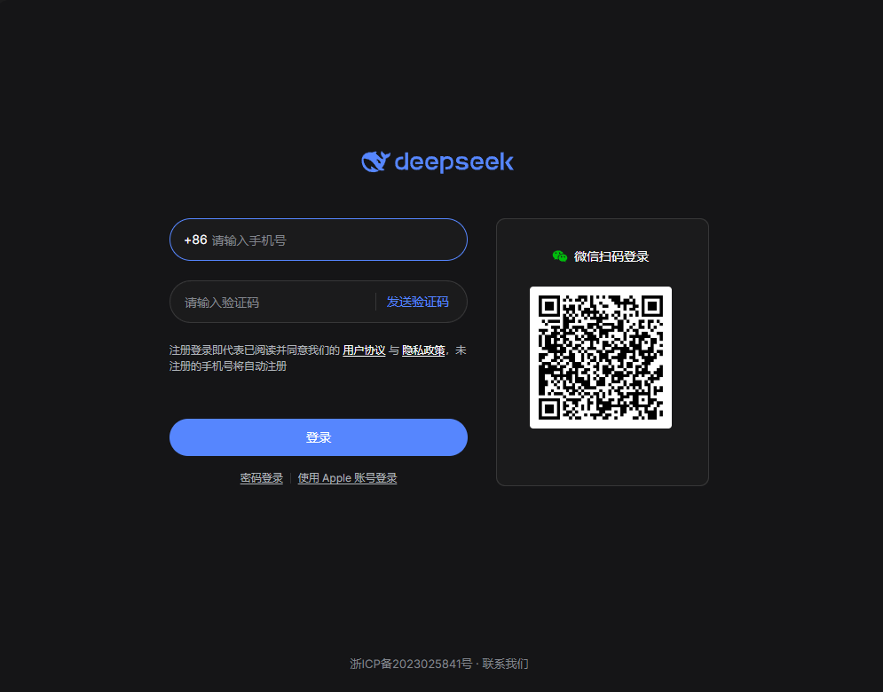
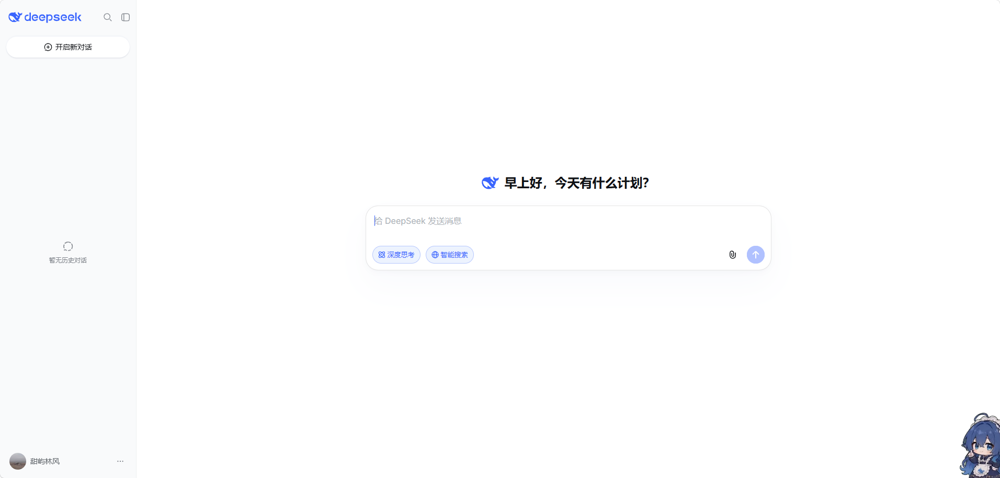

# dsh-plugin-deepseek-chat

[English](README.en.md) | 中文

> **当前版本：v1.4.0** ｜适配 DSH **0.2.2-rc.3**
>
> ⚠️ **「全自动投递通道」为实验性功能，尚未经过真机实验**（仅离线自检通过）。请先小范围试用，异常可用状态栏「■ 停止全自动」随时接管。详情见 [RELEASE_NOTES_v1.4.0.md](docs/RELEASE_NOTES_v1.4.0.md)。
> [GitHub](https://github.com/sweet560/dsh-plugin-deepseek-chat) ｜ [Gitee 镜像](https://gitee.com/wtt520wyl/dsh-plugin-deepseek-chat)

把 `chat.deepseek.com` 嵌进 DSH，并把**桌面会话与网页聊天双向桥接**成自动化工具。npm 包名：`@tianyulinfeng1/dsh-plugin-deepseek-chat`。





## 核心功能

- **三个入口**：左侧栏图标、会话顶栏标签页、右边栏卡片（默认名「DeepSeek 聊天」，可开关/改名），打开同一份铺满会话区的网页聊天，记住上次会话。
- **条件触发式自动闭环**（可选）：桌面一轮完成 → 自动回传网页并发送 → 抓网页回复 → **只写入桌面草稿**，绝不自动执行，是否继续由你定。三道安全阀：最大轮数 / 错误关键词熔断 / 同轮去重。
- **全自动投递通道**（v1.4.0，可选）：桌面会话＝开发 agent、网页聊天＝审查 agent、你＝决策者，串成无人值守链条。审查回复**只提炼 `<TO_DEV>…</TO_DEV>` 区块投递**（网页全文绝不进桌面，省上下文和 Token），经官方 `conversation.send` **自动提交下一轮**；命中完成/重启/用户介入（如「请重启宿主验收」）/重复 2 次/错误/最大轮数即**弹决策卡**（继续/编辑/重试/终止），状态栏一键启停、随时接管。
- **半自动带回**（可选）：不抓网页 DOM，改为手动粘贴网页回复或导出 JSON，绕开超时。
- **设置页**：开关、改名、闭环与全自动配置、关于、检查更新、一键更新。
- **稳定性**：webview 崩溃隔离，只在面板显示「重试」，不拖垮整个 App。

> 各功能的来龙去脉、实现细节与逐版本变更见 [CHANGELOG.md](CHANGELOG.md)，当前版本详见 [RELEASE_NOTES_v1.4.0.md](docs/RELEASE_NOTES_v1.4.0.md)。

## 环境要求

| 项 | 要求 |
|---|---|
| DSH | 桌面版 `0.2.2-rc.3` 或更新 |
| 平台 | Windows / macOS / Linux 桌面壳 |
| git | 仅 GitHub 安装方式需要 |

## 安装

**方式一：npm（推荐）**

```powershell
dsh plugin --profile desktop add @tianyulinfeng1/dsh-plugin-deepseek-chat
```

**方式二：插件页** — DSH 左侧栏「插件」→「安装第三方插件」→ 填 `@tianyulinfeng1/dsh-plugin-deepseek-chat` 或 `github:sweet560/dsh-plugin-deepseek-chat` → 安装。

**方式三：命令行（GitHub）**

```powershell
dsh plugin --profile desktop add github:sweet560/dsh-plugin-deepseek-chat
```

**方式四：本地目录（二次开发）**

```powershell
dsh plugin --profile desktop add file:"<本仓库绝对路径>"
```

装完在「插件 → 已安装插件」确认「DeepSeek 聊天」已启用。

## 使用

- 首次打开在 chat.deepseek.com 登录一次；本次 App 运行期间切面板/会话无需重登。
- **重启 DSH 后需重新登录**（DSH 给内嵌浏览器的是内存分区，退出即清 cookie）。想长期免登录见[登录态持久化](#登录态持久化可选免登录)。
- 会话链接记在 localStorage（key `dsh-plugin-deepseek-chat:last-url`），重启后回到上次会话。
- 设置页：DSH「设置」→ 左侧「DeepSeek 聊天」，可独立开关/改名顶栏标签与右边栏卡片、配置自动闭环与全自动通道，即时生效。
- 选中顶栏标签时网页铺满会话区，点回「对话」恢复。

## 关于「免扫码 / 与 DSH 账号同步」

纯插件**做不到**让网页版复用 DSH 已登录账号——这是 DSH 架构限制：DSH 账号凭据在 Host 进程（`x-dsh-auth-token`），网页版用站点自带 cookie token，两者无兑换入口，渲染层桥也没有写 cookie / 取 token 的 API。故首次仍需在网页扫码一次。v1.1.3 起面板不再显示任何账号状态。

## 登录态持久化（可选，免登录）

DSH 默认给内嵌浏览器分配内存分区（`dsh-sidebar-browser-<uuid>`），重启即清 cookie。可把主进程那行改成固定 `persist:` 分区（两条语句字节数相同，原地替换）实现长期免登录。

完整原因、脚本、验证与回滚步骤见 **[docs/login-persistence.md](docs/login-persistence.md)**。`scripts/` 附「新电脑免改」批处理：`一键补丁.bat` / `回滚.bat` / `find-dsh.ps1`（自动定位 DSH、dry-run 体检、备份回滚）。属修改已安装应用，DSH 升级会覆盖 `app.asar` 需重打补丁，风险自负。

## 已知限制

- 仅桌面版有效；`dsh web` 在浏览器打开时不显示入口。
- chat.deepseek.com 偶尔弹「使用环境异常」提示，属站点行为，与本插件无关。
- 纯插件无法免扫码复用 DSH token（见上）。
- 重启 DSH 后需重登网页，除非打持久分区补丁。

## 版本历史

只列重要里程碑，完整逐版本变更见 **[CHANGELOG.md](CHANGELOG.md)**，各版本发布说明见 [docs/](docs/)：

| 版本 | 里程碑 |
|---|---|
| **1.4.0** | 全自动投递通道（定界符提炼 + 官方 `conversation.send` 自动提交 + 决策卡） |
| **1.3.0** | 手动绑定会话 + 状态栏齿轮跳设置页 + 会话标题 |
| **1.2.1** | 半自动带回（结构化解析官方导出 JSON） |
| **1.2.0** | 条件触发式自动闭环（三道安全阀） |
| **1.1.7** | 右边栏卡片（dsh-better-sidebar） |
| **1.1.1** | 修复切面板/重启反复扫码 |
| **1.0.0** | 首个本地版本 |

## 开发

```powershell
git clone https://github.com/sweet560/dsh-plugin-deepseek-chat.git
cd dsh-plugin-deepseek-chat
node test/check-client.mjs
```

`test/check-client.mjs` 是离线自检：在 `node:vm` 里用假 React/DOM/租约桥验证四处槽位注册、右边栏卡片双路径、配置层、自动闭环、全自动通道、更新链路等，全段 `RESULT: PASS`。

| 文件 | 用途 |
|---|---|
| `lib/client.js` | 浏览器半侧：面板、顶栏浮层、右边栏卡片、设置页、自动闭环/全自动通道、崩溃隔离 |
| `lib/index.js` | 宿主半侧（空实现，提供 Loader 入口） |
| `locale/{zh,en}.json` | 插件页显示名称/描述 |
| `docs/login-persistence.md` | 持久分区补丁说明 |
| `test/check-client.mjs` | 离线自检 |

## 卸载

```powershell
dsh plugin --profile desktop remove @tianyulinfeng1/dsh-plugin-deepseek-chat
```

## 作者

- **作者**：伍悦匿匿 ｜ 437830488@qq.com
- GitHub https://github.com/sweet560 ｜ Gitee https://gitee.com/wtt520wyl
- 镜像仓库 https://gitee.com/wtt520wyl/dsh-plugin-deepseek-chat
- 博客园 https://www.cnblogs.com/wuyuenini/ ｜ CSDN https://blog.csdn.net/weixin_42076389

## 许可证

[MIT](LICENSE)
